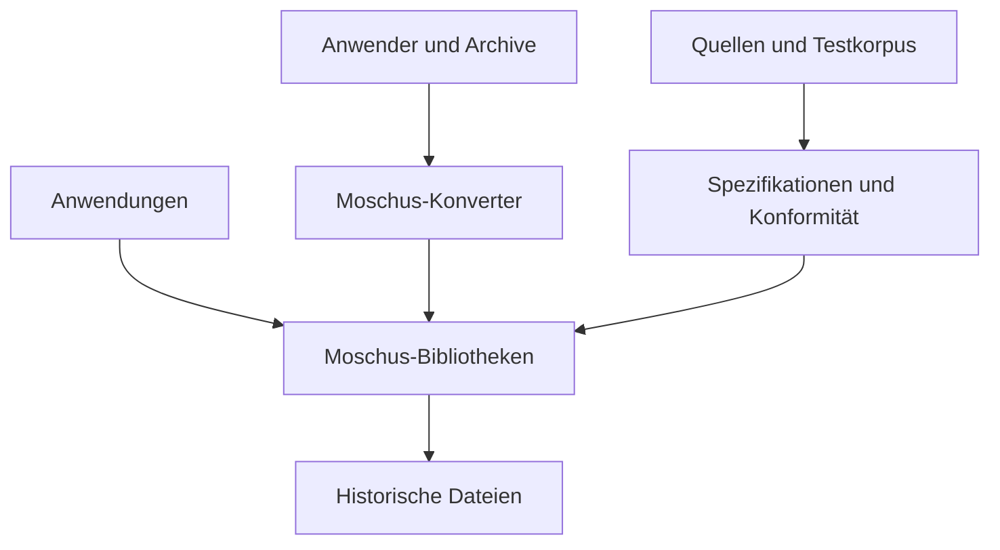
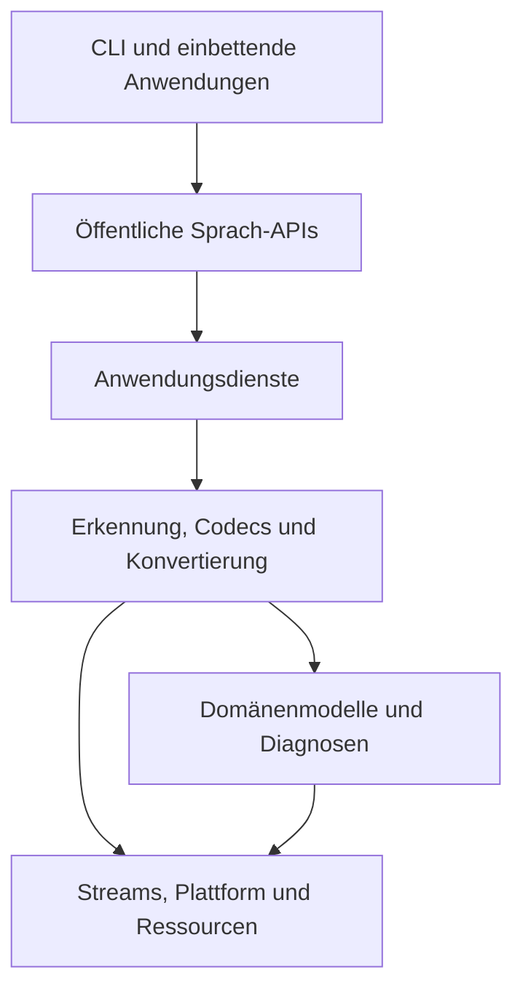
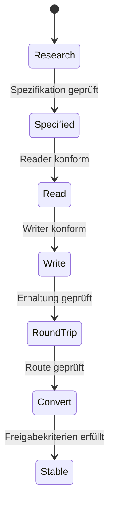
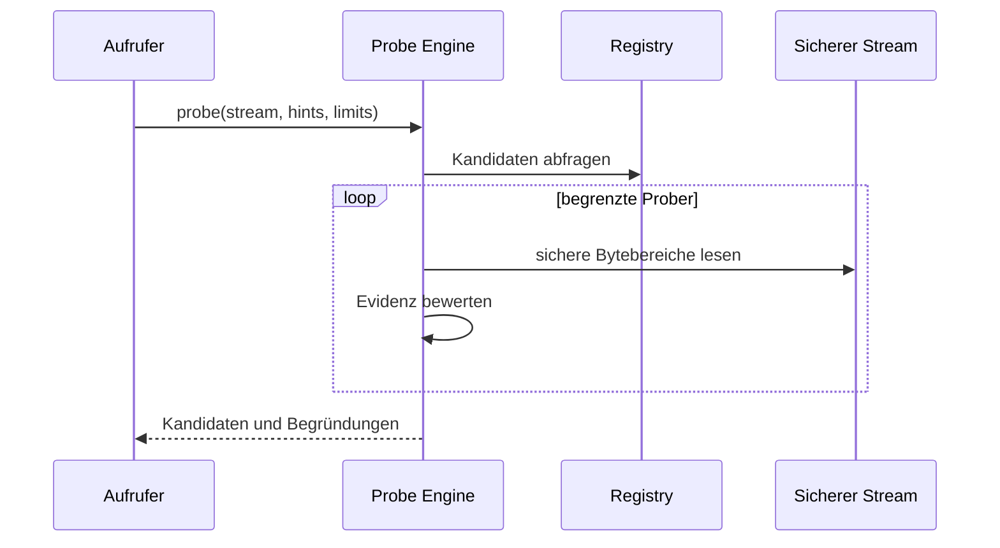
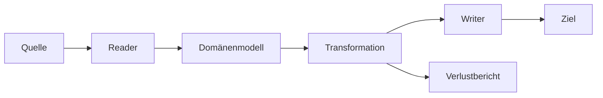
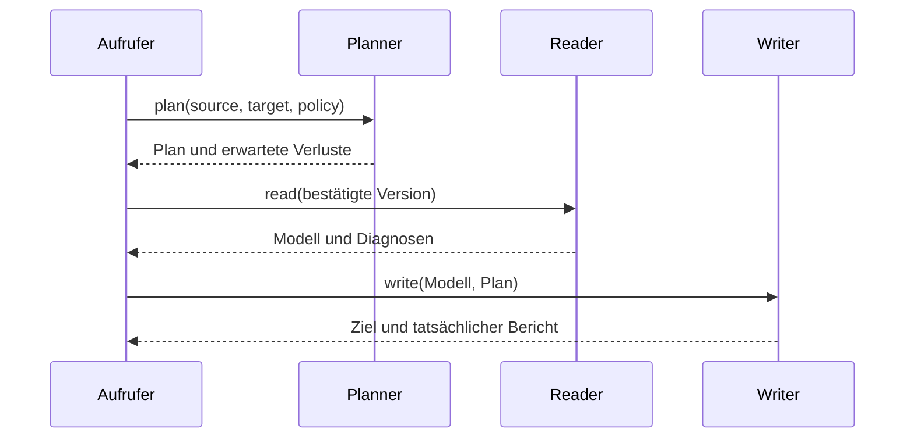

# Architektur — SASD Moschus

| Merkmal | Inhalt |
|---|---|
| Dokument | Verbindliche Architektur-Baseline |
| Projekt | SASD Moschus |
| Auftraggeber und Product Owner | Robin Goerlach / SASD-GmbH |
| Version | 0.2 |
| Stand | 22. Oktober 2026 |
| Status | Zielarchitektur für M0–M8; Detailentscheidungen werden durch ADRs ergänzt |
| Erste Produktepoche | Dateiformate und Werkzeugstand bis einschließlich 31. Dezember 1990 |
| Fachliche Grundlage | [LASTENHEFT.md](LASTENHEFT.md) |
| Technische Anforderungen | [PFLICHTENHEFT.md](PFLICHTENHEFT.md) |
| Umsetzungsfolge | [ROADMAP.md](ROADMAP.md) |

## 1. Zweck des Dokuments

Dieses Dokument beschreibt die technische Gesamtarchitektur von SASD Moschus.
Es legt die stabilen Systemgrenzen, Verantwortlichkeiten, Abhängigkeiten,
Datenflüsse und Qualitätsmechanismen fest, innerhalb derer die Implementierung
erfolgt.

Das Dokument beantwortet insbesondere:

- Welche Bestandteile gehören zu Moschus und welche liegen außerhalb?
- Wie werden Formatwissen, Parser, Writer, Validatoren und Konverter getrennt?
- Wie können mehrere Programmiersprachen dasselbe fachliche Verhalten zeigen?
- Wie bleibt der Kern mit C89/C90 und historischen Werkzeugketten nutzbar?
- Wie werden spätere C++-Standards eingeführt, ohne die 1990-Epoche zu
  verfälschen?
- Wie werden beschädigte oder bösartige Dateien begrenzt verarbeitet?
- Wie werden Informationsverluste erkannt, bewertet und berichtet?
- Wie wird jede Unterstützungsbehauptung durch Spezifikation und Tests belegt?

Die Architektur ist konkreter als das Lastenheft, ersetzt aber weder die
einzelnen Formatspezifikationen noch Detailentscheidungen in Architecture
Decision Records (ADRs).

## 2. Dokumenten- und Entscheidungsordnung

Bei Widersprüchen gilt folgende Rangfolge:

1. geltendes Recht und Lizenzen;
2. akzeptiertes Lastenheft;
3. akzeptiertes Pflichtenheft;
4. dieses Architekturdokument;
5. angenommene ADRs;
6. sprachneutrale Formatspezifikationen und Konformitätsverträge;
7. sprachspezifische API-Dokumentation;
8. Implementierungsdetails.

Eine niedrigere Ebene darf eine höhere nicht stillschweigend verändern. Wird
bei der Umsetzung ein Widerspruch erkannt, wird er dokumentiert und auf der
richtigen Ebene entschieden.

| Kennung | Architekturregel |
|---|---|
| ARC-GOV-001 | Fachliche Ziele werden aus dem Lastenheft und technische Anforderungen aus dem Pflichtenheft abgeleitet. |
| ARC-GOV-002 | Dauerhafte oder schwer umkehrbare Architekturentscheidungen werden zusätzlich als ADR dokumentiert. |
| ARC-GOV-003 | Eine Implementierung darf nicht zur einzigen, undokumentierten Definition eines Dateiformats werden. |
| ARC-GOV-004 | Offene Entscheidungen werden als offen gekennzeichnet und nicht als bestehende Zusage behandelt. |
| ARC-GOV-005 | Jede Abweichung von einer Architekturregel benötigt eine dokumentierte Entscheidung mit Auswirkungen und Rückweg. |

## 3. Architekturtreiber

Die Architektur wird von folgenden Zielen bestimmt, in dieser Reihenfolge:

1. **Korrektheit:** historische Daten dürfen nicht durch moderne Annahmen
   fehlinterpretiert werden.
2. **Transparenz:** Unsicherheit, nicht unterstützte Funktionen und Verluste
   müssen sichtbar sein.
3. **Sicherheit:** jede Eingabe ist potenziell fehlerhaft oder bösartig.
4. **Nachweisbarkeit:** Formatunterstützung entsteht erst durch Quellen,
   Spezifikation und Konformitätstests.
5. **Portabilität:** die erste Epoche benötigt einen kleinen C89/C90-Kern und
   dokumentierte historische Compilerpfade.
6. **Sprachunabhängigkeit:** C, C++, C# und Java sollen dasselbe fachliche
   Verhalten unabhängig implementieren können.
7. **Erweiterbarkeit:** spätere Formate und Sprachepochen werden hinzugefügt,
   ohne abgeschlossene Epochen umzudeuten.
8. **Wartbarkeit:** ein Codec soll lokal verständlich, testbar und ersetzbar
   bleiben.

Bei Zielkonflikten haben Sicherheit, Korrektheit und explizite Diagnose Vorrang
vor Geschwindigkeit, Komfort und nomineller Formatbreite.

## 4. Leitprinzipien

| Kennung | Prinzip | Konsequenz |
|---|---|---|
| ARC-PRN-001 | Version vor Endung | Dateiendungen sind Hinweise, niemals alleiniger Beweis. |
| ARC-PRN-002 | Spezifikation vor Implementierung | Ein stabiler Codec benötigt eine prüfbare, sprachneutrale Beschreibung. |
| ARC-PRN-003 | Keine stillen Verluste | Jede relevante Annahme, Ersetzung und Auslassung wird diagnostiziert. |
| ARC-PRN-004 | Reader und Writer statt Paar-Konverter | Formate werden über geeignete neutrale Modelle verbunden. |
| ARC-PRN-005 | Strikt vor Recovery | Regelkonforme Verarbeitung und Wiederherstellung bleiben getrennte Vorgänge. |
| ARC-PRN-006 | Begrenzung vor Bequemlichkeit | Größen, Offsets, Rekursion und Expansion werden vor Verwendung geprüft. |
| ARC-PRN-007 | Fähigkeiten statt Pauschal-Support | Unterstützung wird pro Version und Operation ausgewiesen. |
| ARC-PRN-008 | Deterministische Ausgabe | Gleiche Eingabe und Optionen erzeugen, soweit möglich, gleiche Bytes. |
| ARC-PRN-009 | Provenienz ist Produktbestandteil | Quellen und Testdatenherkunft gehören zum technischen Nachweis. |
| ARC-PRN-010 | Unabhängige Sprachimplementierungen | Gemeinsame Wahrheit sind Spezifikation und Tests, nicht ein verborgenes FFI. |
| ARC-PRN-011 | Abgeschlossene Epochen bleiben erhalten | Spätere Standards ändern alte Formatsemantik nicht. |
| ARC-PRN-012 | Kein aktiver Fremdinhalt | Makros, Druckerbefehle, Skripte und externe Verweise werden nie automatisch ausgeführt. |

## 5. Systemkontext

Moschus ist eine Bibliotheks- und Werkzeugfamilie. Es ersetzt weder historische
Anwendungen noch ein Betriebssystem oder Emulatoren.



### 5.1 Externe Akteure und Systeme

| Akteur/System | Beziehung zu Moschus |
|---|---|
| Menschlicher Nutzer | untersucht, validiert, konvertiert und bewertet Berichte |
| Einbettende Anwendung | nutzt eine öffentliche Sprachbibliothek |
| Dateisystem oder Stream | liefert Eingabebytes und nimmt Ausgabebytes auf |
| Referenzprogramm | dient lokal zur empirischen Prüfung, ist keine Laufzeitabhängigkeit |
| Historischer Compiler | prüft Portabilität, wird nicht mitgeliefert |
| Öffentliche Standards und Literatur | begründen Formatregeln |
| Testkorpus | belegt positives, negatives und abweichendes Verhalten |
| Build- und CI-System | baut, analysiert und testet freie Referenzkonfigurationen |

### 5.2 Systemgrenzen

Innerhalb der Moschus-Grenze liegen:

- Formatregister und Erkennung;
- Reader, Validatoren, Recovery-Komponenten und Writer;
- neutrale Domänenmodelle;
- Konvertierungsplanung und Verlustdiagnostik;
- öffentliche Bibliotheks-APIs;
- C++-Kommandozeilenanwendung;
- Plattform- und Compilerabstraktion;
- Spezifikationen, Manifeste und verteilbare Testdaten.

Außerhalb liegen:

- Originalanwendungen und deren proprietäre Laufzeitbibliotheken;
- Emulatoren und virtuelle Maschinen;
- proprietäre Compilerpakete;
- automatische Ausführung eingebetteter Programme;
- nicht lizenzierbare Buch-, Disketten- oder Kundendaten;
- Microsoft Access, JPEG und andere spätere Formatziele während M0–M8.

## 6. Logische Gesamtarchitektur

Die Architektur folgt einer gerichteten Schichtung. Abhängigkeiten zeigen nach
innen zu stabileren, fachlicheren Verträgen.



Spezifikationen und Konformitätsdaten stehen neben dem Laufzeitsystem. Sie
definieren und prüfen dessen Verhalten, werden aber nicht von einer konkreten
Sprachimplementierung abhängig.

### 6.1 Schichten

| Schicht | Verantwortung | Darf abhängig sein von | Darf nicht enthalten |
|---|---|---|---|
| Anwendungen | Bedienung, Argumente, Ausgabe, Prozessstatus | öffentliche API | private Parser oder Dateiformatlogik |
| Öffentliche API | stabile, sprachtypische Verträge | Anwendungsdienste, öffentliche Modelle | CLI-spezifische Ausgabe |
| Anwendungsdienste | Probe-, Read-, Validate-, Write- und Convert-Abläufe | Registry, Codecs, Modelle | plattformspezifische Systemaufrufe |
| Codec-Schicht | formatspezifische Dekodierung und Kodierung | Modelle, sichere Streams, Limits | UI, direkte Prozesssteuerung |
| Domänenmodelle | fachliche Inhalte, Herkunft, Erweiterungen | elementare gemeinsame Typen | Datei-I/O und konkrete CLI-Optionen |
| Plattformkern | Bytes, geprüfte Arithmetik, Speicher, Dateien, Compilerunterschiede | C-Laufzeit bzw. definierte OS-Grenze | Formatsemantik |
| Spezifikationen | kanonische Format- und Verhaltensbeschreibung | Quellen und Befunde | Abhängigkeit von C/C++/C#/Java-Code |

| Kennung | Architekturregel |
|---|---|
| ARC-LAY-001 | Höhere Schichten dürfen tiefere Schichten nur über veröffentlichte Verträge benutzen. |
| ARC-LAY-002 | Der Konverter enthält keine eigenen Formatparser. |
| ARC-LAY-003 | Plattformabfragen und Compilerverzweigungen bleiben außerhalb fachlicher Codec-Logik. |
| ARC-LAY-004 | Spezifikationen und Konformitätsmanifeste hängen von keiner Sprachimplementierung ab. |
| ARC-LAY-005 | Zirkuläre Modulabhängigkeiten sind nicht zulässig. |
| ARC-LAY-006 | Gemeinsame Module dürfen nicht aus Bequemlichkeit von einem spezielleren Formatmodul abhängen. |

## 7. Physische Repositoryarchitektur

```text
SASD-Moschus/
├── libraries/
│   ├── c89/                  portabler Kern der 1990-Sprachepoche
│   ├── cpp/                  C++-API und spätere C++-Epochen
│   ├── csharp/               spätere native .NET-Implementierung
│   └── java/                 spätere native JVM-Implementierung
├── platform/                 Compiler-, OS-, Byte- und Ressourcenabstraktion
├── tools/
│   └── converter-cpp/        C++-Kommandozeilenprodukt
├── specifications/           kanonische, sprachneutrale Formatbeschreibungen
├── tests/
│   ├── conformance/          Manifeste und erwartete Ergebnisse
│   └── corpus/               verteilbare Fixtures mit Provenienz
├── examples/                 kleine, ausführbare Nutzungsbeispiele
└── docs/
    ├── adr/                  Architecture Decision Records
    ├── sources/              Quellen- und Forschungsnotizen
    └── format-coverage.md    Versionen und Fähigkeitsstatus
```

Die geplante Ergänzung `docs/adr/` wird mit ADR-0001 angelegt. Historische
Buildskripte oder Paketgeneratoren können später unter `build/` beziehungsweise
`packaging/` hinzukommen; diese Verzeichnisse werden erst mit einem echten
Artefakt erzeugt.

| Kennung | Architekturregel |
|---|---|
| ARC-REP-001 | Repositoryverzeichnisse spiegeln Verantwortungsgrenzen und keine zufälligen Entwicklungsschritte. |
| ARC-REP-002 | Generierte Dateien werden nicht als zweite Quelle der Wahrheit gepflegt. |
| ARC-REP-003 | 8.3-kompatible Quellpakete werden aus kanonischen Quellen erzeugt, nicht parallel editiert. |
| ARC-REP-004 | Proprietäre Werkzeuge oder unklare Testdateien dürfen nicht in das Repository gelangen. |
| ARC-REP-005 | Jede Sprachbibliothek bleibt separat baubar und testbar. |

## 8. Komponentenmodell

### 8.1 Laufzeitkomponenten

| Komponente | Verantwortung | Haupteingaben | Hauptausgaben |
|---|---|---|---|
| Format Registry | bekannte Formate, Versionen und Fähigkeiten registrieren | statische Codec-Beschreibungen | Deskriptoren und Factory-Zugänge |
| Probe Engine | plausible Formate und Versionen ermitteln | Byte-Stream, Hinweise, Limits | geordnete Kandidaten mit Evidenz |
| Reader | bestätigte Version dekodieren | Stream, Optionen, Limits | Domänenmodell und Diagnosen |
| Validator | Struktur und Semantik prüfen | Stream oder Modell, Regelprofil | Validierungsbericht |
| Recovery Engine | begründbare Inhalte aus beschädigten Dateien gewinnen | Stream, explizite Recovery-Optionen | partielles Modell und Recovery-Protokoll |
| Writer | gewählte Zielversion kodieren | Modell, Zielprofil, Optionen | Byte-Stream und Diagnosen |
| Conversion Planner | fachlich mögliche Route und erwartete Verluste planen | Quell- und Zielfähigkeiten | Plan oder begründete Ablehnung |
| Conversion Executor | bestätigten Plan ausführen | Modell, Plan, Ressourcenbudget | Ziel und Ergebnisbericht |
| Diagnostic Catalog | stabile Diagnosecodes und Schweregrade definieren | Diagnoseparameter | strukturierte Diagnose |
| Resource Governor | Ressourcenbudgets überwachen | Limits und Verbrauch | Freigabe oder kontrollierter Abbruch |
| Encoding Service | historische Zeichenkodierungen behandeln | Bytes, Codepage, Policy | Zeichenwerte und Abbildungsdiagnosen |

### 8.2 Entwicklungs- und Nachweiskomponenten

| Komponente | Verantwortung |
|---|---|
| Format Specification | binäre/textuelle Struktur, Regeln, Varianten und Unsicherheiten |
| Coverage Matrix | öffentlicher Status je Formatversion und Fähigkeit |
| Conformance Manifest | Eingabe, Operation, Optionen, erwartetes Ergebnis und Diagnosen |
| Corpus Metadata | Herkunft, Rechte, Hash, historische Einordnung und Eigenschaften |
| Reference Report | Ergebnis eines unabhängigen Programms oder historischen Systems |
| Toolchain Profile | Compiler, Flags, Zielsystem, Speicherprofil und Einschränkungen |

## 9. Sprachneutrales Formatmodell

### 9.1 Formatidentität

Ein Format wird nicht nur durch einen Namen oder eine Endung beschrieben. Seine
kanonische Identität besteht mindestens aus:

| Feld | Bedeutung | Beispielart |
|---|---|---|
| `family` | Formatfamilie | dBASE DBF, GIF, Word |
| `variant` | Hersteller- oder Plattformvariante | dBASE IV, OS/2 Bitmap |
| `version` | belegte On-Disk-Version | GIF87a, GIF89a |
| `profile` | eingeschränkte oder anwendungsbezogene Teilmenge | RTF-1.0-Basisprofil |
| `media_domain` | fachliches Domänenmodell | Tabelle, Dokument, Raster |
| `introduced` | früheste belegte Verfügbarkeit | Datum oder Jahr mit Evidenz |
| `capabilities` | Probe/Read/Validate/Write/Round-trip/Convert | getrennte Zustände |
| `extensions` | typische, nicht beweiskräftige Endungen | `.dbf`, `.gif` |
| `signatures` | strukturelle Erkennungsmerkmale | Byte- oder Recordregeln |

Eine dauerhaft veröffentlichte Formatkennung ist stabil. Umbenennungen ändern
nur die Anzeige, nicht die Identität in Manifesten und Berichten.

### 9.2 Fähigkeitsmodell

Die Statusfolge `Research`, `Specified`, `Read`, `Write`, `Round-trip`,
`Convert`, `Stable` ist ein Reifemodell, keine einzelne boolesche Eigenschaft.
Read und Write werden zusätzlich explizit geführt, da ein sicherer Reader nicht
automatisch einen korrekten Writer bedeutet.

Ein Fähigkeitsdeskriptor enthält:

- Formatkennung und genaue Version;
- Operation;
- unterstützte Records, Felder, Kompressionen und Erweiterungen;
- bekannte Ausschlüsse;
- erforderliche Begleitdateien;
- Zeichensatz- und Plattformregeln;
- Stabilitätsstatus;
- Spezifikations- und Testsuite-Version.

| Kennung | Architekturregel |
|---|---|
| ARC-FMT-001 | Fähigkeitsabfragen müssen feingranularer als „Format unterstützt“ sein. |
| ARC-FMT-002 | Formatkennung, Anzeigename, Dateiendung und MIME-Bezeichnung bleiben getrennte Begriffe. |
| ARC-FMT-003 | Begleitdateien besitzen eigene Identitäten und Beziehungen. |
| ARC-FMT-004 | Spätere Erweiterungen werden einer neuen Version oder einem neuen Profil zugeordnet. |
| ARC-FMT-005 | Ungeklärte historische Einordnung verhindert einen stabilen Status, nicht aber dokumentierte Forschung. |

## 10. Spezifikationsarchitektur

Jede konkrete Formatversion erhält eine sprachneutrale Spezifikation. Ein
einheitliches Schema erleichtert Review, Implementierung und Testableitung.

### 10.1 Pflichtbestandteile einer Formatspezifikation

1. Identität, Namen, Versionen und historischer Zeitraum;
2. Quellenverzeichnis und Bewertung der Quellen;
3. Byte-Reihenfolge, Wortbreiten und Zahlenrepräsentationen;
4. Datei-, Record-, Chunk- oder Tokenstruktur;
5. Feldtabellen mit Offset, Größe, Typ, Bedeutung und Gültigkeitsregeln;
6. Kodierungen, Zeilenenden und Plattformbesonderheiten;
7. Verweise, Offsets, Längen, Prüfsummen und Terminatoren;
8. Kompression und Dekompressionsgrenzen;
9. unbekannte, reservierte und herstellerspezifische Werte;
10. formale und semantische Validierungsregeln;
11. kanonische Writer-Regeln;
12. Preservation- und Round-trip-Policy;
13. bekannte Anwendungsabweichungen;
14. Sicherheits- und Ressourcenrisiken;
15. offene Fragen und empirische Befunde;
16. Zuordnung zu Konformitätsfällen.

### 10.2 Evidenzklassen

| Klasse | Bedeutung |
|---|---|
| Normativ | offizieller Standard oder Herstellerbeschreibung |
| Sekundär | Fachbuch oder unabhängige technische Dokumentation |
| Empirisch | beobachtetes Verhalten eines benannten Referenzprogramms |
| Abgeleitet | nachvollziehbare Schlussfolgerung aus mehreren Befunden |
| Ungeklärt | plausibel, aber noch nicht ausreichend bestätigt |

Jede strittige Regel kennzeichnet ihre Evidenzklasse. Kussmann und Born sind
wichtige Sekundärquellen; sie werden mit Primärquellen und Testdateien
abgeglichen und nicht wörtlich in das Projekt übernommen.

## 11. Sichere Byte- und Streamabstraktion

Codecs arbeiten nicht unmittelbar mit ungesicherten Zeigern oder globalem
Dateizustand. Der Plattformkern stellt kleine, C89-kompatible Verträge bereit.

### 11.1 Eingabestream

Der Eingabevertrag unterstützt, soweit für das Format erforderlich:

- sequenzielles Lesen;
- begrenztes Vorauslesen für Erkennung;
- absolute oder relative Positionierung bei seekfähigen Quellen;
- Abfrage einer bekannten Gesamtlänge;
- Slices mit eigener harter Bereichsgrenze;
- genaue Positionsmeldung für Diagnosen;
- kontrollierte Meldung von EOF, I/O-Fehler und Limitüberschreitung.

Ein Codec darf nie annehmen, dass ein einzelner Leseaufruf die angeforderte
Menge vollständig liefert.

### 11.2 Ausgabestream

Der Ausgabevertrag unterstützt:

- vollständiges beziehungsweise partielles Schreiben mit Fehlerprüfung;
- Positionsabfrage;
- optionales Seek/Patch für Formate mit nachträglichen Längenfeldern;
- Flush und kontrollierten Abschluss;
- transaktionale Dateiausgabe über temporäres Ziel und bestätigte Übernahme.

### 11.3 Geprüfte primitive Operationen

Gemeinsame Funktionen übernehmen:

- Lesen/Schreiben von 8-, 16- und 32-Bit-Werten definierter Byte-Reihenfolge;
- vorzeichenbehaftete Werte ohne undefiniertes Verhalten;
- checked add, subtract, multiply und range;
- Umrechnung zwischen Dateigrößen und adressierbaren Speichergrößen;
- Slice- und Offsetprüfung;
- begrenzte Zeichen- und Bytefolgen;
- Prüfsummen, sofern formatspezifisch benötigt.

| Kennung | Architekturregel |
|---|---|
| ARC-IO-001 | Jede Offset-/Längenrechnung wird vor Zugriff oder Allokation auf Überlauf und Dateigrenze geprüft. |
| ARC-IO-002 | Ein Substream kann seine eigene Grenze nicht überschreiten, auch wenn die Gesamtdatei größer ist. |
| ARC-IO-003 | Reader unterscheiden reguläres Dateiende, abgeschnittene Struktur und I/O-Fehler. |
| ARC-IO-004 | Writer melden partielle Schreibvorgänge und dürfen sie nicht als Erfolg behandeln. |
| ARC-IO-005 | Bestehende Zieldateien werden nur über eine explizite Überschreibentscheidung ersetzt. |

## 12. Codec-Architektur

### 12.1 Trennung der Operationen

Ein Codec ist eine Familie zusammengehöriger, aber getrennter Operationen:

- **Probe:** Kandidat bestimmen, ohne die vollständige Datei zu dekodieren;
- **Read:** bestätigte Version in ein Domänenmodell überführen;
- **Validate:** Regelverletzungen feststellen;
- **Recover:** beschädigte Inhalte mit expliziten Heuristiken gewinnen;
- **Write:** ein Modell in eine ausdrücklich gewählte Zielversion kodieren;
- **Describe:** Fähigkeiten, Grenzen und Metadaten bereitstellen.

Nicht jede Formatversion muss alle Operationen anbieten. Die Registry meldet
nur tatsächlich implementierte und geprüfte Fähigkeiten.

### 12.2 Codec-Deskriptor

Der Deskriptor enthält Daten und Funktionszugänge, aber keinen globalen
veränderlichen Zustand:

- stabile Codec- und Formatkennung;
- unterstützte Versionen/Profile;
- typische Endungen und Signaturen;
- Domänenmodell;
- Funktionszeiger beziehungsweise sprachtypische Interfaces;
- optionale Begleitdateibeziehungen;
- unterstützte Operationen;
- Standardlimits und bekannte harte Grenzen;
- Stabilitätsstatus.

### 12.3 Lebenszyklus



Zwischenschritte können je Format abweichen, da ein Write-only-Generator
theoretisch möglich ist. Eine öffentliche Stable-Einstufung benötigt jedoch
den im Pflichtenheft festgelegten vollständigen Nachweis.

### 12.4 Codec-interne Struktur

Ein komplexer Codec wird intern in kleine Verantwortlichkeiten geteilt:

- Header-/Containerparser;
- Record- oder Chunkiterator;
- Typ- und Werte-Dekoder;
- Referenzauflösung;
- semantischer Modellaufbau;
- Validierungsregeln;
- Writer-Planung;
- Encoder und Layoutberechnung.

Parserergebnisse werden nicht durch globale Variablen zwischen Schritten
transportiert. Kontext, Limits, Optionen, Allocator und Diagnoseziel werden
explizit übergeben.

| Kennung | Architekturregel |
|---|---|
| ARC-COD-001 | Ein Codec registriert nur Fähigkeiten, die er tatsächlich implementiert und testet. |
| ARC-COD-002 | Probe, Read, Validate, Recover und Write bleiben separat aufrufbar. |
| ARC-COD-003 | Reader schreiben keine Ausgabe- oder UI-Texte direkt. |
| ARC-COD-004 | Writer verlangen eine konkrete Zielversion und verlassen sich nicht auf „neueste Version“. |
| ARC-COD-005 | Codec-Kontext enthält alle veränderlichen Vorgangsdaten; versteckter globaler Zustand ist unzulässig. |
| ARC-COD-006 | Unbekannte Werte werden entsprechend der Formatspezifikation abgelehnt, bewahrt oder diagnostiziert. |

## 13. Formaterkennung

Die Probe Engine kombiniert mehrere schwache und starke Evidenzen, ohne eine
Dateiendung zu überschätzen.

### 13.1 Erkennungsstufen

1. verfügbare Hinweise erfassen: Endung, deklarierter Typ, Begleitdateien;
2. minimale sichere Byteprobe lesen;
3. harte Signaturen und Ausschlussregeln prüfen;
4. Strukturplausibilität bewerten;
5. versionsspezifische Merkmale prüfen;
6. Kandidaten nach Konfidenz und Evidenz sortieren;
7. Mehrdeutigkeit erhalten, wenn keine eindeutige Entscheidung möglich ist.

### 13.2 Probe-Ergebnis

Jeder Kandidat enthält:

- Formatkennung und wahrscheinliche Version;
- normierte Konfidenzklasse, nicht nur eine undokumentierte Zahl;
- positive Evidenzen;
- negative oder widersprüchliche Evidenzen;
- benötigte weitere Bytes oder Begleitdateien;
- erkannte Sicherheits- oder Größenauffälligkeiten;
- Hinweis, ob eine Nutzerfestlegung erforderlich ist.

Konfidenzklassen sind mindestens `exact`, `strong`, `plausible`, `weak` und
`rejected`. Die genaue Gewichtung wird in ADR-0001 und einem Probe-Vertrag
festgelegt, bevor der erste Codec als `Read` gilt.



| Kennung | Architekturregel |
|---|---|
| ARC-PRB-001 | Probe-Funktionen verändern weder Eingabe noch globalen Zustand. |
| ARC-PRB-002 | Die Erkennung besitzt ein separates, kleines Ressourcenbudget. |
| ARC-PRB-003 | Mehrdeutigkeit wird als Ergebnis modelliert und nicht willkürlich aufgelöst. |
| ARC-PRB-004 | Eine Nutzerfestlegung wird weiterhin auf Mindestplausibilität und Sicherheit geprüft. |
| ARC-PRB-005 | Erkennung und vollständige Validierung sind unterschiedliche Operationen. |

## 14. Neutrale Domänenmodelle

Moschus verwendet nicht ein universelles Objektmodell für alle Dateien.
Stattdessen besitzt jede semantisch zusammengehörige Domäne ein Modell. So
bleiben sinnvolle Konvertierungen möglich, ohne fachfremde Inhalte zu erfinden.

### 14.1 Gemeinsamer Modellkopf

Jedes Modell trägt:

- Quellformat, Version und Profil;
- Herkunft und relevante Dateibeziehungen;
- angewandte Leseoptionen und Zeichensatzannahmen;
- Vollständigkeits- und Gültigkeitsstatus;
- Diagnosen und Recovery-Spuren;
- bewahrte Erweiterungsdaten;
- optional Quellpositionszuordnungen.

### 14.2 Tabellarisches Modell

Repräsentiert:

- geordnete Tabellen oder Sheets;
- Spaltennamen, Datentypen, Breiten und Skalen;
- Datensätze/Zellen und Null-/Leer-Semantik;
- gelöschte oder ausgeblendete Datensätze als expliziten Zustand;
- Formeln zusätzlich zu berechneten Werten, sofern vorhanden;
- Formatierung und anwendungsbezogene Metadaten als optionale Fähigkeiten;
- Memo-/Langtextbeziehungen;
- ursprüngliche Zeichenkodierung und nicht abbildbare Bytes.

Das Modell unterscheidet fehlend, leer, Null, gelöscht und ungültig. Diese
Zustände dürfen nicht aus Komfort zu einem einzigen leeren Wert kollabieren.

### 14.3 Dokumentmodell

Repräsentiert in abgestufter Form:

- Dokumenteigenschaften und Abschnitte;
- Absätze, Zeichenläufe und Steuerzeichen;
- Stile und direkte Formatierung;
- Tabellen, Listen, Felder, Fußnoten und Verweise, soweit unterstützt;
- eingebettete oder verknüpfte Objekte nur als nicht ausführbare Ressourcen;
- Seiten- und Druckinformationen als deklarative Metadaten.

Textinhalt, logische Struktur und visuelles Layout besitzen getrennte
Erhaltungsgrade. Eine reine Textextraktion ist nicht gleich einer vollständigen
Dokumentkonvertierung.

### 14.4 Rastermodell

Repräsentiert:

- Breite, Höhe, Orientierung und Pixelaspekt;
- Farbmodell, Palette, Bittiefe und Transparenz;
- ein oder mehrere Bilder/Frames;
- Timing und Schleifeninformation, sofern historisch vorhanden;
- Auflösung und Metadaten;
- Originalkompressions- oder Erweiterungsblöcke, wenn Preservation zugesagt ist.

Dekodierte Pixel und bewahrte codierte Daten sind verschiedene Fähigkeiten.

### 14.5 Vektor- und Metadateimodell

Repräsentiert:

- Koordinatensysteme und Einheiten;
- Zeichenoperationen, Pfade, Primitive und Text;
- Stift-, Pinsel-, Farb- und Schriftressourcen;
- Transformationen, Clipping und Seitenzustand;
- nicht ausführbare Druck- oder Gerätebefehle als deklarative Operationen;
- unbekannte Records in einer kontrollierten Erweiterungszone.

### 14.6 Erweiterungscontainer

Quellspezifische Informationen dürfen kontrolliert erhalten werden, ohne die
gemeinsamen Felder zu verfälschen. Jeder Erweiterungseintrag enthält:

- Namensraum und stabile Kennung;
- Quellformat und Version;
- Datentyp und Roh- oder strukturierte Darstellung;
- Preservation-Policy;
- Sicherheitsklassifikation;
- Quellposition, wenn verfügbar.

Ein Zielwriter darf Erweiterungsdaten nur verwenden, wenn er deren Semantik
kennt. Unbekannte Daten werden nicht blind in ein anderes Format injiziert.

| Kennung | Architekturregel |
|---|---|
| ARC-MOD-001 | Domänenmodelle bilden fachliche Semantik und nicht die Klassenstruktur eines einzelnen Formats ab. |
| ARC-MOD-002 | Quellspezifische Daten werden über typisierte Erweiterungen statt über beliebige Schlüssel-Wert-Sammlungen bewahrt. |
| ARC-MOD-003 | Jeder Modellwert kann, soweit erforderlich, Herkunft und Verluststatus tragen. |
| ARC-MOD-004 | Aktive Inhalte bleiben deklarative Daten und werden nie durch das Modell ausgeführt. |
| ARC-MOD-005 | Ein universelles „Alles-in-einem“-Modell wird nicht eingeführt. |

## 15. Validierung und Recovery

### 15.1 Validierungsebenen

| Ebene | Prüft | Beispiel |
|---|---|---|
| Container | äußere Struktur und Grenzen | Chunklänge liegt in Datei |
| Syntaktisch | Record- und Feldregeln | gültiger Typcode |
| Semantisch | Beziehungen und Werte | Datensatzanzahl stimmt |
| Profil | konkrete Versions- oder Anwendungsregeln | Feature erst ab späterer Version |
| Kompatibilität | bekannte Leser-/Writergrenzen | historische Anwendung lehnt Wert ab |

Ein Validierungsbericht unterscheidet mindestens `info`, `warning`, `error`
und `fatal`. Gültigkeit wird aus definierten Regeln berechnet; eine Datei kann
lesbar, aber ungültig sein.

### 15.2 Recovery-Architektur

Recovery ist kein toleranter Schalter im normalen Reader, sondern ein eigener
Anwendungsfall. Er darf Reader-Bausteine wiederverwenden, muss aber jede
Heuristik offenlegen.

Recovery-Schritte:

1. striktes Ergebnis und Abbruchstelle erfassen;
2. erlaubte Heuristiken aus dem Formatprofil wählen;
3. Suchfenster und Ressourcenbudget begrenzen;
4. wiedergewonnene Segmente mit Konfidenz und Herkunft markieren;
5. Lücken, Ersetzungen und verworfene Bytes protokollieren;
6. ein partielles Modell mit Status `recovered` liefern;
7. niemals das Original überschreiben.

| Kennung | Architekturregel |
|---|---|
| ARC-VAL-001 | Parserdiagnose und Validierungsbefund verwenden denselben strukturierten Diagnosevertrag. |
| ARC-VAL-002 | Recovery kann eine Datei nicht nachträglich als formal gültig erklären. |
| ARC-VAL-003 | Jede Recovery-Heuristik ist formatspezifisch dokumentiert und separat testbar. |
| ARC-VAL-004 | Validatoren dürfen auf Stream- und Modellebene arbeiten, müssen ihre Prüfebene aber ausweisen. |
| ARC-VAL-005 | Unbekannte reservierte Werte werden gemäß Profil als Hinweis, Fehler oder bewahrbare Erweiterung behandelt. |

## 16. Writer-Architektur

Schreiben ist kein einfaches Rückwärtsausführen des Readers. Writer erstellen
zunächst einen Plan und erst danach Bytes.

### 16.1 Writer-Phasen

1. Zielversion und Profil bestätigen;
2. Modell gegen Zielfähigkeiten prüfen;
3. Zeichensatz-, Typ- und Werteabbildungen planen;
4. nicht darstellbare Inhalte diagnostizieren;
5. bei erlaubter Verlustpolitik einen unveränderlichen Schreibplan erzeugen;
6. Größen und Layout mit checked arithmetic berechnen;
7. in temporäres oder vom Aufrufer geliefertes Ziel schreiben;
8. Ausgabe strukturell nachprüfen, soweit konfiguriert;
9. erst nach Erfolg die Zieldatei übernehmen.

### 16.2 Preservation- und Canonicalization-Policy

Writer können je Format folgende Modi anbieten:

- `canonical`: normgerechte, reproduzierbare Darstellung;
- `preserve`: bekannte, sichere Quelldetails möglichst erhalten;
- `compatible`: Beschränkung auf ein benanntes Referenzprofil;
- `exact-round-trip`: nur wenn unveränderte Bereiche nachweisbar bytegleich
  bewahrt werden können.

Die Modi sind keine globalen Versprechen. Eine Formatspezifikation legt exakt
fest, welche Aspekte erhalten werden.

| Kennung | Architekturregel |
|---|---|
| ARC-WRT-001 | Writer führen eine verlustfreie Vorprüfung durch, bevor sie Nutzdaten ausgeben. |
| ARC-WRT-002 | Nicht darstellbare Inhalte führen ohne passende Verlustfreigabe zum Abbruch. |
| ARC-WRT-003 | Zeitstempel, Reihenfolgen und Padding werden deterministisch gesetzt, sofern das Format dies zulässt. |
| ARC-WRT-004 | Writer dürfen keine spätere Formatversion aufgrund bequemerer Funktionen wählen. |
| ARC-WRT-005 | Nach einem Fehler bleibt keine Datei zurück, die wie ein bestätigtes Ergebnis aussieht. |

## 17. Konvertierungsarchitektur

Moschus implementiert keine Matrix aus direkten Paar-Konvertern. Ein Reader
erzeugt ein Domänenmodell, eine Transformation passt dieses Modell kontrolliert
an, und ein Writer erzeugt das Ziel.



### 17.1 Conversion Planner

Der Planner benötigt:

- bestätigtes Quellformat und Read-Fähigkeiten;
- Zielversion und Write-Fähigkeiten;
- Domäne und Modellfähigkeiten;
- Nutzerpolitik für Verluste und Annahmen;
- Ressourcenlimits;
- gewünschte Kompatibilitätsoptionen.

Er liefert entweder:

- einen geordneten, vor Ausführung prüfbaren Plan;
- mehrere mögliche Pläne mit unterschiedlichen Erhaltungsgraden; oder
- eine begründete Ablehnung.

### 17.2 Transformationsschritte

Transformationen sind explizite, benannte Schritte, zum Beispiel:

- Zeichensatzabbildung;
- Datentypverengung oder -erweiterung;
- Datums-/Zeitnormalisierung;
- Formel-zu-Wert-Reduktion;
- Stil- oder Farbreduktion;
- Auflösung von Memo- oder Ressourcenverweisen;
- Entfernung nicht unterstützter Metadaten.

Jeder Schritt beschreibt Vorbedingung, Ergebnis, mögliche Verluste und
Diagnosen. Versteckte Änderungen in einem Writer sind zu vermeiden.

### 17.3 Verlustklassifikation

| Klasse | Bedeutung | Beispiel |
|---|---|---|
| Exact | Semantik und zugesagte Darstellung bleiben erhalten | gleiche Ganzzahlbreite |
| Normalized | Semantik bleibt, Darstellung wird kanonisiert | Padding oder Recordreihenfolge |
| Approximated | Inhalt wird angenähert | nicht vorhandene Farbe |
| Dropped | Inhalt kann nicht übertragen werden | nicht unterstützte Metadaten |
| Assumed | fehlende Information wird ausdrücklich angenommen | gewählte Codepage |
| Recovered | Inhalt stammt aus Recovery | übersprungener beschädigter Record |
| Rejected | Route ist unter der aktuellen Policy unzulässig | Schlüsselwert passt nicht ins Ziel |

### 17.4 Konvertierungsablauf



| Kennung | Architekturregel |
|---|---|
| ARC-CNV-001 | Eine Route existiert nur zwischen fachlich kompatiblen Domänen. |
| ARC-CNV-002 | Erwartete Verluste sind vor der Ausführung und tatsächliche Verluste danach verfügbar. |
| ARC-CNV-003 | Transformationen sind benannt, versioniert und unabhängig testbar. |
| ARC-CNV-004 | Der Standardmodus lehnt nicht freigegebene verlustbehaftete Schritte ab. |
| ARC-CNV-005 | Direkte optimierte Routen dürfen nur ergänzt werden, wenn sie dasselbe Diagnose- und Konformitätsverhalten erfüllen. |
| ARC-CNV-006 | dBASE nach Access wird erst in einer späteren Formatepoche als Route ergänzt. |

## 18. Diagnose- und Ergebnismodell

Alle Schichten verwenden denselben konzeptionellen Diagnosevertrag. Eine
Diagnose enthält:

- stabile Kennung;
- Schweregrad;
- Kategorie;
- Operation und Formatkontext;
- menschenlesbare Nachricht;
- Parameter für lokalisierte Darstellung;
- Byte-, Record-, Feld- oder Modellposition;
- betroffene Quell- und Zieleigenschaft;
- Auswirkung auf Gültigkeit, Vollständigkeit und Verluststatus;
- optional Handlungshinweis und Quellenregel.

### 18.1 Kategorien

- Formatidentifikation;
- Syntax/Struktur;
- Semantik;
- Kompatibilität;
- Verlust/Approximation;
- Recovery;
- Sicherheit/Ressourcen;
- I/O;
- Bedienung/Konfiguration;
- interner Fehler.

### 18.2 Ergebnisobjekt

Jede öffentliche Operation liefert fachlich:

- Status;
- Ergebniswert oder kein Ergebnis;
- geordnete Diagnosen;
- Verbrauchs- und Vollständigkeitsinformationen;
- relevante Format-/Versionskennung;
- optional maschinenlesbare Statistik.

Fehler werden im C89-Kern über explizite Statuswerte transportiert. Spätere
Sprach-APIs dürfen idiomatische Ausnahmen anbieten, müssen jedoch Status und
Diagnosen verlustfrei abbilden.

| Kennung | Architekturregel |
|---|---|
| ARC-DIA-001 | Diagnosekennungen bleiben über kompatible Releases stabil. |
| ARC-DIA-002 | Bibliotheken schreiben standardmäßig weder auf stdout noch stderr. |
| ARC-DIA-003 | Lokalisierte Texte sind Darstellung; Kennung und Parameter bilden den maschinenlesbaren Vertrag. |
| ARC-DIA-004 | Ein interner Fehler ist von ungültiger Benutzereingabe unterscheidbar. |
| ARC-DIA-005 | Verlustdiagnosen sind Teil des Konvertierungsergebnisses und kein optionales Debugprotokoll. |

## 19. Ressourcen- und Sicherheitsarchitektur

### 19.1 Vertrauensgrenzen

Untrusted sind:

- alle Dateibytes und Metadaten;
- Dateinamen und Pfade;
- eingebettete Offsets, Längen und Zähler;
- komprimierte Daten;
- Querverweise und Verkettungen;
- Zeichensätze und Textsequenzen;
- Begleitdateibeziehungen;
- CLI-Optionen aus fremden Automatisierungen;
- fremde Konformitäts- oder Korpusdateien vor Aufnahmeprüfung.

Trusted sind nur versionierter Moschus-Code, freigegebene Spezifikationen und
vom Aufrufer ausdrücklich gesetzte Richtlinien. Auch vertrauenswürdiger Code
prüft untrusted Werte an jeder Grenze.

### 19.2 Ressourcenbudget

Ein `ResourceLimits`-Kontext enthält mindestens:

- maximale Eingabe- und Ausgabebytes;
- maximale Allokation und Gesamtspeicher;
- maximale Records, Chunks, Felder, Bilder und Seiten;
- maximale Rekursions-/Verschachtelungstiefe;
- maximale Dekompressionsausgabe und Expansionsrate;
- maximale Verweisauflösungen und Zyklusschritte;
- optional Zeit- oder Operationsbudget in modernen Hosts;
- eigenes kleineres Budget für Probe und Recovery-Suche.

Der `ResourceGovernor` rechnet Verbrauch vor der Operation an. Ein Limitfehler
ist kontrolliert, reproduzierbar und enthält die betroffene Grenze.

### 19.3 Bedrohungen und Kontrollen

| Bedrohung | Architekturkontrolle |
|---|---|
| Integerüberlauf | zentrale checked arithmetic |
| Out-of-bounds | begrenzte Streams und Slices |
| Speichererschöpfung | Allokations- und Gesamtbudgets |
| Dekompressionsbombe | Output- und Ratio-Limits |
| Endlosschleife/Zyklus | Zähler, Besuchsmarken und Schrittlimits |
| Rekursionsüberlauf | explizite Tiefenbegrenzung oder iterative Verarbeitung |
| Pfadtraversal | keine unkontrollierte Materialisierung eingebetteter Pfade |
| Code-/Makroausführung | rein deklarative Behandlung, keine Ausführung |
| Netzwerkzugriff | Kernbibliothek besitzt keinen impliziten Netzwerkzugriff |
| Teilweise Zieldatei | transaktionales Schreiben |
| Diagnose-Datenleck | kontrollierte Ausgabe, keine ungefragte Telemetrie |

### 19.4 Aktive Formate

PostScript/EPS, PCL und ähnliche Formate können Befehle enthalten. Die
1990-Architektur interpretiert nur einen ausdrücklich spezifizierten,
begrenzten Teil als Datenstruktur. Es wird kein allgemeiner Interpreter und
kein Druckerspooler in den Codec eingebettet. Nicht unterstützte Befehle werden
bewahrt, beschrieben oder abgelehnt – niemals ausgeführt.

| Kennung | Architekturregel |
|---|---|
| ARC-SEC-001 | Ressourcengrenzen gelten in strict, probe, validate, convert und recovery. |
| ARC-SEC-002 | Kein Codec öffnet selbstständig Netzwerkverbindungen oder externe Programme. |
| ARC-SEC-003 | Begleitdateien werden nur über einen vom Aufrufer kontrollierten Resolver bezogen. |
| ARC-SEC-004 | Eingebettete Pfade werden als Daten behandelt und nicht ungeprüft auf das Host-Dateisystem abgebildet. |
| ARC-SEC-005 | Sicherheitsrelevante Parseränderungen benötigen Negativtests. |
| ARC-SEC-006 | Debug- und Recovery-Modi dürfen Schutzprüfungen nicht deaktivieren. |

## 20. Zeichenkodierung und Textarchitektur

Historische Dateien verwenden nicht automatisch UTF-8 oder dieselbe Codepage
wie das Hostsystem. Kodierung ist deshalb Teil der Formatinterpretation.

### 20.1 Interne Darstellung

Für die C89-Baseline wird eine sprach- und compilerunabhängig definierte
Unicode-Codepoint- beziehungsweise normalisierte Textdarstellung verwendet;
der konkrete C-Typ und die API werden in ADR-0003 festgelegt. Ein Host-`char`
ist ohne Profil keine Textkodierung.

### 20.2 Dekodierinformationen

Ein dekodierter Textwert kann zusätzlich tragen:

- deklarierte oder erkannte Quellkodierung;
- Konfidenz und Herkunft der Annahme;
- ursprüngliche Bytes für nicht round-trip-fähige Sequenzen;
- Ersatz- und Fehlerpositionen;
- Normalisierungsstatus;
- Steuerzeichenklassifikation.

### 20.3 Policies

- `strict`: ungültige oder nicht abbildbare Sequenz abbrechen;
- `replace`: mit ausdrücklicher Diagnose ersetzen;
- `preserve-bytes`: Rohbytes zusätzlich bewahren;
- `user-selected`: Nutzer setzt eine Codepage mit protokollierter Annahme.

| Kennung | Architekturregel |
|---|---|
| ARC-TXT-001 | Kodierung wird durch Formatregel, Dateimerkmal oder explizite Policy bestimmt, nie still durch die Host-Locale. |
| ARC-TXT-002 | Zeilenenden und Steuerzeichen werden getrennt von der Zeichenkodierung behandelt. |
| ARC-TXT-003 | Eine verlustbehaftete Zeichenabbildung erzeugt eine positionsbezogene Diagnose. |
| ARC-TXT-004 | Dateinamenkodierung der Plattform ist nicht automatisch Inhaltskodierung. |
| ARC-TXT-005 | Normalisierung erfolgt nur, wenn das Zielprofil oder eine ausdrückliche Option sie verlangt. |

## 21. Speicher- und Zustandsmodell

### 21.1 C89-Baseline

Da historische Compiler und DOS-Speichermodelle unterstützt werden sollen,
vermeidet der portable Kern Annahmen über große zusammenhängende Speicherblöcke.

Der Kern verwendet:

- explizite Besitzer- und Lebenszeitregeln;
- übergebbare Allocator-Funktionen;
- geprüfte Größen vor jeder Allokation;
- kleine, freigebbare Teilstrukturen;
- Streaming oder Iteratoren, wo das Format dies zulässt;
- Cleanup-Pfade, die auch nach Teilfehlern sicher sind;
- keine Abhängigkeit von Garbage Collection oder Exceptions.

### 21.2 Arena- und Objektallokation

Eine optionale Arena kann für kurzlebige Parseobjekte verwendet werden, darf
aber keine Ressourcenlimits umgehen. Große Nutzdaten sollen über Blöcke,
Streams oder Aufrufer-Sinks verarbeitet werden können. Eigentum wird in jeder
öffentlichen C-Funktion dokumentiert.

### 21.3 Reentranz und Parallelität

Der portable Kern ist auf reentrante, voneinander unabhängige Operationen
ausgelegt. Er verspricht in der 1990-Epoche keine interne Parallelisierung.
Mehrere Vorgänge dürfen in modernen Hosts parallel laufen, wenn jeder eigenen
Kontext, Allocator und Diagnose-Sink besitzt.

| Kennung | Architekturregel |
|---|---|
| ARC-MEM-001 | Kein veränderlicher globaler Codec-Zustand. |
| ARC-MEM-002 | Eigentum und Freigabeverantwortung sind Bestandteil jedes öffentlichen C-Vertrags. |
| ARC-MEM-003 | Allokationsfehler sind reguläre, getestete Fehlerpfade. |
| ARC-MEM-004 | Große Dateien erzwingen nicht grundsätzlich eine gleich große Speicherallokation. |
| ARC-MEM-005 | Thread-Sicherheit wird pro API-Ebene dokumentiert und nicht nur angenommen. |

## 22. C89/C90-Kern und C++-Fassade

### 22.1 Portabler Kern

`libraries/c89/` enthält die kleinste ausführbare Referenz der 1990-Epoche:

- gemeinsame Status- und Diagnoseverträge;
- sichere Byte-/Streamprimitive;
- Ressourcenlimits und geprüfte Arithmetik;
- Formatregister;
- Domänenmodellgrundlagen;
- Codecs der aktiven Meilensteine;
- Konformitätsadapter.

Öffentliche Symbole erhalten ein einheitliches Projektpräfix. Header sind aus C
und, wo vorgesehen, aus C++ nutzbar. Abhängigkeiten auf C99, POSIX oder
compilerproprietäre Erweiterungen sind im portablen Kern nicht zulässig.

### 22.2 C++-Bibliothek

`libraries/cpp/` bietet eine C++-gerechte Fassade:

- typsichere Handles und RAII, soweit die aktive Epoche es erlaubt;
- Container- und Stringadapter innerhalb der Compilergrenzen;
- keine zweite, abweichende Formatsemantik;
- transparente Abbildung aller Diagnosen und Verlustinformationen;
- Möglichkeit späterer nativer C++-Implementierung hinter stabilen Verträgen.

Für die 1990-Epoche wird der genaue gemeinsame Nenner von Turbo C++, Microsoft
C/C++ und dem Referenzcompiler durch ADR-0002 festgelegt. „C++ von 1990“ wird
nicht als unklare Versionsbezeichnung verwendet.

### 22.3 C++-Konverter

Der Konverter nutzt ausschließlich die öffentliche C++-Fassade. Er darf keine
Sonderzugänge zum C-Kern oder zu privaten Codecstrukturen erhalten. Dadurch ist
er zugleich realistischer Integrations- und API-Test.

| Kennung | Architekturregel |
|---|---|
| ARC-LNG-001 | Der C89/C90-Kern bleibt bis zum Abschluss der 1990-Epoche frei von neueren Sprachmerkmalen. |
| ARC-LNG-002 | Die C++-Fassade besitzt keine fachlich abweichenden Regeln. |
| ARC-LNG-003 | C++-Komfort darf strukturierte Diagnosen oder Ressourcenlimits nicht verbergen. |
| ARC-LNG-004 | Der Konverter kompiliert nur gegen öffentliche Header. |
| ARC-LNG-005 | Jede Sprachepoche wird in einem getrennten, verhaltensbewahrenden Meilenstein eingeführt. |

## 23. Weitere Sprachbibliotheken

C# und Java sind geplante eigenständige Bibliotheken, keine bloßen
Prozesswrapper um das C++-Werkzeug. Sie teilen mit C/C++:

- Formatkennungen;
- Spezifikationen;
- Fähigkeitssemantik;
- Diagnosekennungen und Kategorien;
- Konformitätsmanifeste;
- verteilbare Korpusdateien;
- Preservation- und Verlustregeln.

Sie dürfen sprachtypisch abweichen bei:

- Benennung und Namespacegestaltung;
- Speicher- und Lebenszeitverwaltung;
- Stream-, Collection- und Fehler-APIs;
- synchronen und später optional asynchronen Fassaden;
- Paketierung.

Eine FFI-Anbindung an den C-Kern kann später als zusätzliches Paket entstehen,
gilt aber nicht als unabhängige Referenzimplementierung und darf nicht die
nativ geplante Bibliothek ersetzen.

| Kennung | Architekturregel |
|---|---|
| ARC-XLG-001 | Sprachübergreifende Gleichheit wird über beobachtbares Verhalten, nicht über identische Klassenformen definiert. |
| ARC-XLG-002 | Jede Sprache meldet dieselbe Formatidentität und dieselben fachlichen Diagnosecodes. |
| ARC-XLG-003 | Sprachspezifische Zusatzfunktionen dürfen gemeinsame Sicherheits- und Verlustregeln nicht abschwächen. |
| ARC-XLG-004 | Das Konformitätsmanifest bleibt ohne Ausführung einer bestimmten Sprache interpretierbar. |

## 24. Plattform- und Compilerarchitektur

`platform/` kapselt Unterschiede, die nicht zur Formatsemantik gehören.

### 24.1 Zuständigkeiten

- Compiler- und Featureerkennung;
- exakte Integerbreiten und statische/Buildzeit-Prüfungen;
- Endian-sichere Byteoperationen;
- Datei- und Streamadapter;
- Binärmodus und Zeilenendebehandlung;
- Pfad- und Dateinamenadapter;
- 16-Bit-/DOS-Speicherprofile;
- Export-/Calling-Convention-Makros;
- Zeit-, Locale- und Umgebungszugriffe nur über kontrollierte Adapter;
- sichere Fallbacks bei fehlenden Standardfunktionen.

### 24.2 Compilerprofile

| Profil | Zweck | Status |
|---|---|---|
| Modern GCC strict C90 | frei verfügbare Referenz und CI-Baseline | MUSS |
| Modern Clang mit C90-Warnprofil | zusätzliche Diagnose, sofern praktikabel | SOLL |
| Turbo C / Turbo C++ | historischer lokaler Nachweis | Version durch ADR-0002 |
| Microsoft C / C++ | historischer lokaler Nachweis | Version durch ADR-0002 |
| Moderne Sanitizer-Builds | Laufzeitfehler und Undefined Behavior finden | MUSS vor M8 |

Compilerprofile bestehen aus versionierten Flags und erwarteten Fähigkeiten.
Unbekannte Compiler werden nicht automatisch als bekannte Compiler behandelt;
sie nutzen einen konservativen Portabilitätspfad oder werden mit verständlicher
Meldung abgelehnt.

### 24.3 Bedingte Übersetzung

Präprozessorzweige sind zulässig für:

- Compiler-/OS-Erkennung;
- Calling Conventions und Symbolsichtbarkeit;
- fehlende Standardbibliotheksfunktionen;
- Integer- und Speicherprofile;
- Dateisystem- und Binärmodusadapter.

Sie sind nicht zulässig, um unterschiedliche Formatsemantik für verschiedene
Compiler zu implementieren. Solche Unterschiede gehören in benannte
Kompatibilitätsprofile und gemeinsame Tests.

| Kennung | Architekturregel |
|---|---|
| ARC-PLT-001 | Compilerzweige werden zentral definiert und nicht in Codecs verstreut. |
| ARC-PLT-002 | Jeder Plattformfallback besitzt denselben öffentlichen Vertrag und eigene Tests. |
| ARC-PLT-003 | Proprietäre Header dürfen öffentliche portable Header nicht kontaminieren. |
| ARC-PLT-004 | Die Bytebreite und notwendigen Integergrößen werden beim Build nachweisbar geprüft. |
| ARC-PLT-005 | Historische Builds ergänzen moderne Sicherheitsprüfungen, sie ersetzen sie nicht. |

## 25. Kommandozeilenarchitektur

Das Programm `moschus` ist eine dünne Anwendung über der C++-Bibliothek.

### 25.1 Befehlsstruktur

Geplante Kernbefehle:

- `moschus info <file>` — erkennen und Metadaten berichten;
- `moschus probe <file>` — Kandidaten und Evidenz anzeigen;
- `moschus validate <file>` — gegen Version/Profil prüfen;
- `moschus convert <source> <target>` — planen und ausführen;
- `moschus formats` — Formate, Versionen und Fähigkeiten auflisten.

Weitere Unterbefehle werden nur ergänzt, wenn sie eine eigene fachliche
Operation darstellen. Aliasnamen dürfen die Semantik nicht ändern.

### 25.2 Adapter

Die CLI besteht aus:

1. Argumentparser;
2. Konfigurations- und Policy-Auflösung;
3. Adapter auf öffentliche Bibliotheksdienste;
4. menschenlesbarem Renderer;
5. maschinenlesbarem Renderer;
6. stabiler Abbildung auf Prozessstatuscodes.

### 25.3 Ausgabe

Menschenlesbare Texte können weiterentwickelt und lokalisiert werden.
Maschinenlesbare Ausgabe besitzt ein versioniertes Schema. Daten gehen in der
Regel auf stdout, Diagnosen/Bedienfehler auf stderr; bei strukturiertem
Gesamtbericht werden beide Rollen eindeutig im Dokument modelliert.

Keine Farbe ist alleiniger Informationsträger. Farbe wird bei nicht
interaktiver Ausgabe standardmäßig deaktiviert oder eindeutig steuerbar.

### 25.4 Konfiguration

Priorität von niedrig nach hoch:

1. eingebaute sichere Standardwerte;
2. optionale Konfigurationsdatei;
3. ausdrücklich dokumentierte Umgebungsvariablen;
4. Kommandozeilenoptionen.

Historische Builds können nur eine Teilmenge der Konfigurationsquellen
unterstützen. Das wird als Plattformfähigkeit ausgewiesen.

| Kennung | Architekturregel |
|---|---|
| ARC-CLI-001 | Die CLI dupliziert keine Codec- oder Konvertierungslogik. |
| ARC-CLI-002 | Nichtinteraktive Nutzung ist bei vollständigen Optionen deterministisch. |
| ARC-CLI-003 | Maschinenlesbare Ausgabe trägt eine Schema-Version. |
| ARC-CLI-004 | Prozessstatuscodes unterscheiden mindestens Erfolg, Warnung/Verlust, ungültige Datei, Bedienfehler, Ressourcenfehler und internen Fehler. |
| ARC-CLI-005 | Ein Dry-run verwendet denselben Planner wie die anschließende Konvertierung. |

## 26. Test- und Konformitätsarchitektur

### 26.1 Testpyramide

| Ebene | Zweck |
|---|---|
| Primitive Unit Tests | checked arithmetic, Endian, Streams, Allocator, Kodierung |
| Codec Unit Tests | Records, Chunks, Felder, Fehlerpfade |
| Specification Tests | konkrete Regeln und bekannte Abweichungen |
| Conformance Tests | sprachübergreifend beobachtbares Verhalten |
| Integration Tests | vollständige Probe/Read/Validate/Write/Convert-Abläufe |
| Reference Tests | Vergleich mit Standards oder historischen Anwendungen |
| Robustness Tests | Trunkierung, Mutation, Limits, Fuzzing, Sanitizer |
| Build Tests | Compiler-, Plattform- und Paketprofile |

### 26.2 Konformitätsmanifest

Ein Manifest beschreibt ohne sprachspezifischen Code:

- stabile Fallkennung;
- Eingabedatei und kryptografischen Hash;
- Formatversion und Operation;
- Optionen, Limits und Begleitdateien;
- erwarteten Status;
- erwartete Diagnosen oder Diagnosemengen;
- erwartete Modellprojektion;
- bei Writer-Fällen Zielhash oder semantische Prüfregeln;
- Round-trip-Kriterien;
- Quellen- und Provenienzverweise.

Große Modellresultate werden über kanonische, gezielte Projektionen geprüft,
nicht zwingend über ein fragiles Komplettabbild interner Objekte.

### 26.3 Korpusklassen

- synthetische Minimaldateien;
- öffentlich lizenzierte reale Dateien;
- Grenzwertdateien;
- gezielt abgeschnittene Dateien;
- strukturell ungültige Dateien;
- Dateien mit unbekannten Erweiterungen;
- Referenzprogramm-Ausgaben;
- lokale, nicht verteilbare Dateien, die nur über Metadaten und Hash
  referenziert werden.

### 26.4 Fuzzing

Fuzzziele werden an kleinen, stabilen Grenzen angesetzt:

- Prober;
- Header- und Recordparser;
- Dekompressoren;
- Zeichenkodierer/-dekodierer;
- vollständige Reader mit harten Limits.

Jeder reproduzierbare Fehler wird minimiert, klassifiziert und als Regression
aufgenommen, soweit Rechte und Datenschutz es erlauben.

| Kennung | Architekturregel |
|---|---|
| ARC-TST-001 | Ein Stable-Status ist ohne automatisierten Konformitätsnachweis nicht möglich. |
| ARC-TST-002 | Negative und Trunkierungstests sind für Parser gleichrangig mit Happy-Path-Tests. |
| ARC-TST-003 | Tests dürfen keine zeit-, locale- oder hostabhängigen Erwartungen enthalten, sofern dies nicht Gegenstand des Tests ist. |
| ARC-TST-004 | Jede Korpusdatei besitzt Provenienz, Rechteinformation und Hash. |
| ARC-TST-005 | Sprachimplementierungen verwenden dieselben fachlichen Manifeste. |
| ARC-TST-006 | Historische Referenzergebnisse werden mit Programmversion und Umgebung dokumentiert. |

## 27. Build- und Integrationsarchitektur

### 27.1 Moderne Referenzpipeline

Die freie automatisierte Pipeline führt schrittweise aus:

1. Dokument- und Schema-Prüfungen;
2. strikten C90-Build des portablen Kerns;
3. aktiven C++-Epochen-Build;
4. Unit- und Integrationstests;
5. Konformitätstests;
6. Compilerwarnungen als Fehler im festgelegten Profil;
7. statische Analyse;
8. Sanitizer-Builds auf geeigneten Hosts;
9. ausgewählte Fuzz-Smoke-Tests;
10. Paket- und Reproduzierbarkeitsprüfungen.

### 27.2 Historische Builds

Proprietäre Toolchains werden in lokalen, dokumentierten Umgebungen ausgeführt.
Das Repository enthält:

- erwartete Compileridentität und Version;
- Setup-Anleitung ohne proprietäre Dateien;
- Buildskripte/Projektdateien, soweit frei verteilbar;
- erwartete Flags und Speicherprofile;
- protokollierbares Ergebnisformat;
- bekannte Einschränkungen.

Ein historischer Erfolgsbericht ist einem Commit und einem generierten
Quellpaket zugeordnet. Manuelle Schritte werden minimiert, aber ehrlich
dokumentiert.

### 27.3 Reproduzierbarkeit

Releases fixieren:

- Quellcommit und Tag;
- Generator- und Schema-Versionen;
- freie Abhängigkeiten mit Version und Hash;
- Buildprofil;
- Konformitätsmanifest-Version;
- Paketchecksummen;
- abweichende nichtdeterministische Metadaten, falls unvermeidbar.

| Kennung | Architekturregel |
|---|---|
| ARC-BLD-001 | Generierte Artefakte sind auf kanonische Quellen und Generatorversion zurückführbar. |
| ARC-BLD-002 | Ein Build darf keine Formatdaten unkontrolliert aus dem Netzwerk nachladen. |
| ARC-BLD-003 | Compilerwarnprofile sind versioniert und absichtliche Ausnahmen lokal begründet. |
| ARC-BLD-004 | Proprietäre Toolchain-Ergebnisse sind Zusatznachweise; die freie Baseline bleibt baubar. |
| ARC-BLD-005 | Releasepakete werden aus einem sauberen, bezeichneten Quellstand erzeugt. |

## 28. Deployment- und Nutzungsmodelle

### 28.1 Eingebettete Bibliothek

Eine Anwendung linkt genau eine Sprachbibliothek und stellt Streams, Optionen,
Limits und gegebenenfalls Begleitdateiresolver bereit. Moschus benötigt keinen
Dienstprozess und keine Datenbank.

### 28.2 Lokaler Konverter

Der C++-Konverter arbeitet auf lokalen Dateien oder standardisierten Streams.
Er benötigt keine Cloudanmeldung und versendet keine Telemetrie.

### 28.3 Stapel- und Archivworkflow

Ein aufrufendes Skript oder System steuert viele einzelne Operationen und
sammelt maschinenlesbare Berichte. Fehler einer Datei dürfen, gemäß gewählter
Policy, die Ergebnisse anderer Dateien nicht verfälschen.

### 28.4 Späterer Dienstbetrieb

Ein Netzwerkdienst gehört nicht zur 1990-Epoche. Sollte später ein REST- oder
Serverprodukt entstehen, bleibt es ein äußerer Adapter mit zusätzlicher
Authentifizierung, Isolation, Quoten und Datenschutzprüfung. Die Kernbibliothek
erhält deshalb keinen eingebauten Netzwerkzugriff.

## 29. Versionierungs- und Epochenarchitektur

Moschus trennt vier unabhängige Versionsebenen:

| Ebene | Beispiel | Zweck |
|---|---|---|
| Produktversion | Moschus 0.x / 1.x | Release und API-Kompatibilität |
| Formatversion | GIF87a, dBASE IV | On-Disk-Semantik |
| Formatepoche | bis 1990 | historischer Funktionsumfang |
| Sprachepoche | C89/C90, C++98, … C++20 | erlaubter Implementierungsstandard |

Eine Änderung der Sprachepoche darf nicht stillschweigend eine Formatversion
oder Konvertierungssemantik ändern. Eine neue Formatepoche darf auf einer
neueren Sprachepoche aufbauen, muss aber alte Konformitätsfälle weiterführen.

### 29.1 Geplante Sprachepochen

1. C89/C90-Kern plus festgelegter früher C++-Teil für 1990;
2. C++98;
3. C++03;
4. C++11;
5. C++14;
6. C++17;
7. C++20.

Jede Migration besitzt:

- eigenes ADR beziehungsweise Migrationsdokument;
- Compiler- und Plattformmatrix;
- verhaltensbewahrende Zwischencommits;
- vollständige 1990-Konformität;
- API-Kompatibilitätsbewertung;
- Abschluss-Tag.

| Kennung | Architekturregel |
|---|---|
| ARC-VER-001 | Format- und Sprachepochen werden in Planung und Releases getrennt benannt. |
| ARC-VER-002 | Historische Writer benötigen immer eine explizite Zielversion. |
| ARC-VER-003 | Öffentliche stabile APIs folgen semantischer Versionierung. |
| ARC-VER-004 | Diagnose- und Formatschemaänderungen besitzen eigene Versionierung und Migration. |
| ARC-VER-005 | Der Tag `format-era-1990` wird erst nach vollständiger M8-Abnahme gesetzt und danach nicht verschoben. |

## 30. Erweiterungsarchitektur

### 30.1 Neue Formatversion

Der normale Erweiterungsweg ist:

1. Coverage-Eintrag und historische Abgrenzung;
2. Quellen- und Rechteprüfung;
3. Spezifikation;
4. Testkorpus und Konformitätsfälle;
5. Probe/Reader/Validator;
6. Writer;
7. Round-trip und sinnvolle Konvertierungsrouten;
8. Statusanhebung nach Review.

### 30.2 Registrierung

In der 1990-Epoche werden Codecs statisch registriert. Das vereinfacht
Portabilität, Sicherheit und historische Builds. Eine spätere Plugin-ABI ist
nicht ausgeschlossen, benötigt aber ein eigenes ADR mit:

- ABI- und Versionsstrategie;
- Vertrauens- und Signaturmodell;
- Prozessisolation;
- Ressourcen- und Fehlergrenzen;
- deterministischer Registrierung;
- Paket- und Lizenzmodell.

### 30.3 Neue Domäne

Eine neue Domäne wird nur eingeführt, wenn bestehende Modelle ihre Semantik
nicht sauber ausdrücken können. Erforderlich sind Domänenvertrag,
Erhaltungsebenen, Konvertierungsgrenzen und gemeinsame Tests.

| Kennung | Architekturregel |
|---|---|
| ARC-EXT-001 | Neue Codecs benötigen keine Änderung am Konverterkern, abgesehen von Registrierung und Darstellung neuer Fähigkeiten. |
| ARC-EXT-002 | Plugins sind nicht Teil der 1990-Baseline. |
| ARC-EXT-003 | Ein neues Format darf gemeinsame Modelle erweitern, aber keine formatspezifischen Felder ungeprüft verallgemeinern. |
| ARC-EXT-004 | Erweiterungspunkte besitzen klare Versions- und Fehlergrenzen. |

## 31. Datenschutz, Protokollierung und Telemetrie

Die Bibliotheken erzeugen strukturierte Diagnosen, aber keine eigenständige
Telemetrie. Der Konverter protokolliert nur lokal und auf Wunsch des Nutzers.

Grundregeln:

- keine automatische Übertragung von Dateiinhalten, Dateinamen oder Hashes;
- keine implizite Netzwerkverbindung;
- Berichte enthalten standardmäßig nur für die Operation notwendige Daten;
- Byte-Dumps und Inhaltsausschnitte sind explizite Diagnoseoptionen;
- sensible Pfade können in maschinenlesbaren Berichten redigiert werden;
- temporäre Dateien werden kontrolliert erstellt und nach Fehlern bereinigt;
- die aufrufende Anwendung entscheidet über dauerhafte Protokollspeicherung.

| Kennung | Architekturregel |
|---|---|
| ARC-PRI-001 | Moschus ist standardmäßig offline und telemetriefrei. |
| ARC-PRI-002 | Diagnoseausgaben enthalten keine ungefragten vollständigen Inhalte. |
| ARC-PRI-003 | Temporäre Daten erben mindestens die Schutzanforderungen des Zielvorgangs. |
| ARC-PRI-004 | Hashes werden als Identifikatoren behandelt, nicht als Beweis fehlender Sensibilität. |

## 32. Leistungsarchitektur

Leistung wird nach Korrektheit und Sicherheit optimiert. Wichtige Strategien:

- begrenztes Streaming statt pauschalem Komplettladen;
- einmalige strukturelle Indizierung nur bei echtem Nutzen;
- Chunk-/Recorditeratoren;
- kontrollierte Pufferwiederverwendung;
- lazy Dekodierung großer Blobs, Bilder oder Memos;
- keine wiederholte Vollprobe desselben Streams innerhalb eines Vorgangs;
- messbare Referenzkorpora pro Domäne;
- separate Messung von I/O, Dekodierung, Transformation und Kodierung.

Zeitlimits sind auf historischen Systemen nicht immer portabel. Harte Mengen-,
Tiefen- und Schrittlimits bilden deshalb die primäre deterministische
Begrenzung; moderne Hosts können ergänzende Zeitbudgets verwenden.

| Kennung | Architekturregel |
|---|---|
| ARC-PER-001 | Performanceoptimierungen werden mit repräsentativen Dateien gemessen. |
| ARC-PER-002 | Ein schneller Pfad umgeht keine Validierungs- oder Sicherheitsgrenze. |
| ARC-PER-003 | Speicher- und Zeitverhalten werden getrennt bewertet. |
| ARC-PER-004 | Leistungsregressionen werden je aktiver Referenzplattform beobachtet. |

## 33. Fehlerbehandlung und Ausfallsicherheit

Fehlerklassen:

- ungültiges Argument oder Bedienfehler;
- unbekanntes/mehrdeutiges Format;
- nicht unterstützte Fähigkeit;
- ungültige oder abgeschnittene Datei;
- Ressourcenlimit;
- I/O- oder Speichermangel;
- nicht akzeptierter Informationsverlust;
- interner Vertragsbruch.

Bibliothekscode beendet niemals eigenmächtig den Prozess. Er gibt Kontrolle,
Status und Diagnosen an den Aufrufer zurück. Cleanup ist idempotent, soweit
praktikabel. Ein Fehler in einer Stapeldatei darf keine gemeinsam genutzten
Registry- oder Konfigurationsdaten beschädigen.

Debug-Assertions dienen Programmierfehlern; sie ersetzen keine Prüfung von
Dateidaten. Release-Builds müssen untrusted Eingaben kontrolliert ablehnen,
auch wenn Assertions deaktiviert sind.

| Kennung | Architekturregel |
|---|---|
| ARC-ERR-001 | Ungültige Eingaben führen nicht zu Prozessabbruch durch Bibliothekscode. |
| ARC-ERR-002 | Fehlerpfade geben erworbene Ressourcen deterministisch frei. |
| ARC-ERR-003 | Ein interner Vertragsbruch wird nicht als gewöhnlicher Dateifehler verschleiert. |
| ARC-ERR-004 | Teilresultate tragen einen unmissverständlichen Vollständigkeitsstatus. |

## 34. Rückverfolgbarkeit

Die Rückverfolgbarkeitskette lautet:

```text
Lastenheft-Anforderung
    -> Pflichtenheft-Anforderung
        -> Architekturregel / ADR
            -> Formatspezifikation oder API-Vertrag
                -> Implementierung
                    -> Konformitäts- und Regressionstest
                        -> Abnahmenachweis
```

Für kleine Detailfunktionen kann eine Ebene nicht anwendbar sein; der
Abnahmenachweis muss dies kenntlich machen. Stable-Behauptungen benötigen eine
durchgängige Kette.

### 34.1 Primäre Zuordnung

| Architekturbereich | Lastenheft | Pflichtenheft |
|---|---|---|
| Governance und Prinzipien | LAS-DOK, LAS-ZIE, LAS-TRA | Abschnitte 1, 3, 29 |
| Formate und Spezifikationen | LAS-EPO, LAS-FMT, LAS-QUE | Abschnitte 8, 9, 15 |
| Codec und I/O | LAS-ERK, LAS-LES, LAS-VAL, LAS-SCH | Abschnitte 9, 10 |
| Konvertierung und Modelle | LAS-KON, LAS-QUA | Abschnitte 7, 11 |
| Sicherheit und Ressourcen | LAS-REC, LAS-SEC, LAS-LEI | Abschnitte 10, 17, 18 |
| Sprache und Plattform | LAS-API, LAS-POR | Abschnitte 12, 13, 19, 20 |
| CLI | LAS-CLI, LAS-BED | Abschnitt 14 |
| Test und Release | LAS-LIE, LAS-ABN, LAS-GES | Abschnitte 19, 22, 24–26 |

| Kennung | Architekturregel |
|---|---|
| ARC-TRA-001 | Stable-Codecs besitzen dokumentierte Verknüpfungen von Regel, Implementierung und Test. |
| ARC-TRA-002 | Architekturregeln werden bei Einführung der Prüfwerkzeuge maschinenlesbar referenzierbar gemacht. |
| ARC-TRA-003 | Ein Releasebericht nennt nicht erfüllte oder nicht anwendbare Anforderungen ausdrücklich. |

## 35. Architecture Decision Records

ADRs werden unveränderlich nummeriert. Ihr Status ist `Proposed`, `Accepted`,
`Superseded` oder `Rejected`. Eine ersetzte Entscheidung bleibt erhalten und
verweist auf ihre Nachfolgerin.

### 35.1 Vorgesehene ADRs

| ADR | Thema | Dringlichkeit |
|---|---|---|
| ADR-0001 | Schichten, Registry, Diagnose- und öffentliche API-Grenzen | vor erster öffentlicher API |
| ADR-0002 | exakte GCC-, Turbo-C/C++-, Microsoft-C/C++-, DOS- und Speichermodellmatrix | vor Retro-Builds |
| ADR-0003 | interne Textdarstellung und Codepage-Verträge im C89-Kern | vor erstem Text-/Tabellencodec |
| ADR-0004 | sprachneutrales Konformitätsmanifest und kanonische Ergebnisprojektion | vor erstem Stable-Codec |
| ADR-0005 | Allokator-, Ownership- und Streamverträge | vor öffentlicher C-API |
| ADR-0006 | Formatkennung, Versions- und Profilnamensschema | vor Ausbau der Coverage-Matrix |
| ADR-0007 | Ressourcenlimit-Standardprofile einschließlich DOS16 | vor erstem komplexen Binärparser |
| ADR-0008 | CLI-Schema, Prozessstatuscodes und Verlustfreigabe | vor erstem `convert`-Release |
| ADR-0009 | reproduzierbare Tags und Übergang C++98 bis C++20 | vor M8-Abschluss |

Dieses Dokument nimmt den ADRs keine Detailentscheidung vorweg. Bis ein ADR
angenommen ist, gilt der konservativste mit dieser Architektur vereinbare Weg.

## 36. Architekturprüfung pro Änderung

Ein Review prüft abhängig vom Änderungstyp:

### 36.1 Bei neuen Codecs

- exakte Formatversion und Quellenlage;
- Schicht- und Registry-Einordnung;
- sichere Offsets, Längen und Allokationen;
- Limits und Kompressionsgrenzen;
- Diagnosen und unbekannte Werte;
- Strict-/Recovery-Trennung;
- Writer- und Preservation-Policy;
- Konformitäts-, Negativ- und Trunkierungstests;
- Korpusrechte;
- Coverage-Status.

### 36.2 Bei API-Änderungen

- Abwärtskompatibilität und Versionierung;
- C89/C90- beziehungsweise aktive Sprachepoche;
- Ownership und Fehlerpfade;
- sprachübergreifende Abbildbarkeit;
- strukturierte Diagnosen;
- Test- und Dokumentationsanpassung.

### 36.3 Bei Plattformänderungen

- Isolation in `platform/`;
- konservativer Fallback;
- freie Referenzpipeline;
- historische Compilerfolgen;
- 8.3-Quellpaket;
- keine abweichende Formatsemantik.

### 36.4 Bei Konvertierungsrouten

- gemeinsame Domäne;
- expliziter Plan;
- erwartete und tatsächliche Verluste;
- Ablehnungsverhalten;
- unabhängige Reader-/Writer-Tests;
- End-to-End-Konformität.

## 37. Bekannte Risiken und Architekturantworten

| Risiko | Architekturantwort | Restrisiko |
|---|---|---|
| Variantenexplosion | genaue Kennungen, Profile und Fähigkeitsmatrix | hoher Forschungsaufwand |
| Unvollständige Literatur | Evidenzklassen, mehrere Quellen, empirische Tests | manche Varianten bleiben Research |
| N×M-Konverter | Domänenmodelle und Planner | Spezialfälle benötigen Transformationen |
| C89 begrenzt Ausdruckskraft | kleine Verträge, expliziter Kontext, C++-Fassade | mehr manueller Cleanup |
| Historische Compilerabweichung | Plattformschicht und Toolchainprofile | proprietäre Tests nicht in öffentlicher CI |
| Sprachdrift | Spezifikationen, Codes und gemeinsame Manifeste | unterschiedliche Releasegeschwindigkeit |
| Schadateien | begrenzte Streams, Budgets, Fuzzing | unbekannte Implementierungsfehler |
| Round-trip-Versprechen zu breit | formatspezifische Preservation-Policy | Referenzprogramme können abweichen |
| Testdaten nicht verteilbar | synthetische Fixtures und Hashreferenzen | erschwerte Reproduktion für Dritte |
| Spätere Modernisierung bricht Historie | unveränderliche Epochen-Tags und Gesamtsuite | Pflege mehrerer Buildprofile |

## 38. Bewusst verworfene Alternativen

### 38.1 Direkter Konverter für jedes Formatpaar

Verworfen, weil Zahl und Inkonsistenz der Routen quadratisch wachsen und
Verlustregeln mehrfach implementiert würden.

### 38.2 Ein universelles, untypisiertes Datenmodell

Verworfen, weil Tabellen-, Dokument-, Raster- und Vektorsemanik nicht sinnvoll
auf beliebige Schlüssel-Wert-Paare reduziert werden kann.

### 38.3 Dateiendung als primäre Erkennung

Verworfen, weil historische Endungen uneindeutig, falsch oder nicht vorhanden
sind.

### 38.4 Ein einziger toleranter Parser

Verworfen, weil Validität, Lesbarkeit und Recovery ununterscheidbar würden.

### 38.5 C++20 von Beginn an

Für die 1990-Epoche verworfen, weil es das vereinbarte historische
Portabilitätsziel aufheben würde. C++20 bleibt ein geplanter späterer
Sprachmeilenstein.

### 38.6 FFI als einzige Mehrsprachenstrategie

Verworfen, weil die gewünschte unabhängige Überprüfbarkeit, idiomatische APIs
und langfristige Sprachautonomie nicht erreicht würden.

### 38.7 Dynamische Plugins in der 1990-Baseline

Verworfen, weil ABI, Sicherheit und historische Plattformen unnötig
verkompliziert würden. Statische Registry ist die Baseline.

## 39. Offene Architekturentscheidungen

| Kennung | Frage | Entscheidungsträger / Artefakt | Spätester Zeitpunkt |
|---|---|---|---|
| OPEN-ARC-001 | Exakte Compiler- und DOS-Zielversionen | ADR-0002 | vor M1-Retro-Build |
| OPEN-ARC-002 | Interne Textrepräsentation des C89-Kerns | ADR-0003 | vor M2 |
| OPEN-ARC-003 | Serialisierungsformat der Konformitätsmanifeste | ADR-0004 | vor erstem Codec-Status Read |
| OPEN-ARC-004 | Exakte C-Ownership- und Allocator-API | ADR-0005 | vor öffentlicher C-API |
| OPEN-ARC-005 | Formatkennungs- und Profilsyntax | ADR-0006 | vor großem Coverage-Ausbau |
| OPEN-ARC-006 | Standard-Ressourcenprofile für modern, DOS32 und DOS16 | ADR-0007 | vor komplexen Binärformaten |
| OPEN-ARC-007 | Maschinenlesbares CLI-Ausgabeformat und Schemaversionierung | ADR-0008 | vor M2-CLI |
| OPEN-ARC-008 | Umfang eigenständiger C++-Implementierung gegenüber C-Kern-Fassade | ADR nach M8 | vor C++98-Migration |
| OPEN-ARC-009 | Zeitpunkt und Reihenfolge von C# und Java | Roadmap/ADR | nach stabilen gemeinsamen Verträgen |
| OPEN-ARC-010 | Spätere Plugin- oder Dienstschnittstelle | separates Lastenheft/ADR | nicht Teil M0–M8 |

## 40. Architektur-Abnahmekriterien für M8

Die Architektur der 1990-Epoche gilt als umgesetzt, wenn:

1. Schichten und Abhängigkeitsregeln in Build und Reviews nachweisbar sind;
2. der Konverter ausschließlich öffentliche C++-APIs verwendet;
3. Formatidentität und Fähigkeitsmodell für alle freigegebenen Versionen gelten;
4. jede freigegebene Version eine sprachneutrale Spezifikation besitzt;
5. Probe, Read, Validate, Recover und Write getrennte Verträge haben;
6. neutrale Domänenmodelle alle freigegebenen Konvertierungsrouten tragen;
7. Conversion Planner und Verlustberichte vor und nach Ausführung funktionieren;
8. sichere Streams, checked arithmetic und Ressourcenbudgets durchgehend
   verwendet und negativ getestet werden;
9. kein Codec aktiven Fremdinhalt ausführt oder unkontrolliert externe Daten
   abruft;
10. der C89/C90-Kern mit der freien Referenztoolchain streng gebaut wird;
11. ausgewählte Turbo- und Microsoft-Toolchains gemäß ADR-0002 dokumentiert
    nachgewiesen sind;
12. gemeinsame Konformitätsmanifeste die veröffentlichten Fähigkeiten belegen;
13. Korpusprovenienz und Rechte für alle verteilten Dateien vollständig sind;
14. Build- und Releaseartefakte einem unveränderlichen Commit zuordenbar sind;
15. alle offenen M8-relevanten ADRs entschieden oder die betroffene Funktion
    aus der Freigabe entfernt wurde;
16. der Tag `format-era-1990` den vollständig abgenommenen Stand dauerhaft
    bezeichnet.

## 41. Nächste Architekturschritte

In der Reihenfolge von M0:

1. `docs/adr/` mit ADR-Vorlage anlegen;
2. ADR-0001 für Schichten, Registry, Diagnosen und API-Grenzen entscheiden;
3. ADR-0002 für Compiler, DOS-Ziele und Speichermodelle recherchieren;
4. ADR-0006 für kanonische Formatkennungen vorziehen;
5. Schema der Formatspezifikationen festlegen;
6. ADR-0004 für Konformitätsmanifeste erstellen;
7. ADR-0005 und ADR-0007 vor dem C89-Grundgerüst entscheiden;
8. erst danach öffentliche Header oder Codec-APIs festschreiben.

Damit bleibt die erste Implementierung klein, prüfbar und historisch passend,
ohne die spätere Entwicklung bis C++20 oder weitere Sprachbibliotheken zu
blockieren.

## 42. Änderungshistorie

| Version | Datum | Änderung |
|---|---|---|
| 0.1 | vor 22. Oktober 2026 | Erste Architekturgrundlage mit Schichten, neutralen Modellen und Konverterprinzip |
| 0.2 | 22. Oktober 2026 | Vollständige Architektur-Baseline mit Systemkontext, Komponenten-, Codec-, Daten-, Sicherheits-, Plattform-, Test-, Build- und Epochenarchitektur |
