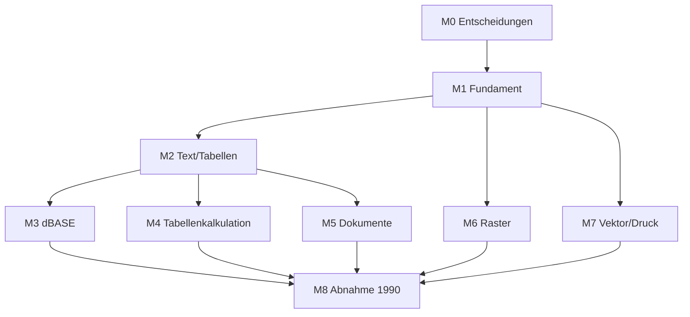

# Roadmap — SASD Moschus

| Merkmal | Inhalt |
|---|---|
| Dokument | Entwicklungs- und Release-Roadmap |
| Version | 0.2 |
| Stand | 22. Oktober 2026 |
| Status | Verbindliche Planungsgrundlage; keine Terminzusage |
| Erste Zielmarke | Abgenommene Formatepoche bis 31. Dezember 1990 |
| Fachliche Grundlage | [LASTENHEFT.md](LASTENHEFT.md) |
| Technische Grundlage | [PFLICHTENHEFT.md](PFLICHTENHEFT.md) |
| Architektur | [ARCHITECTURE.md](ARCHITECTURE.md) |

## 1. Zweck

Diese Roadmap zerlegt das Ziel von SASD Moschus in kleine, überprüfbare
Meilensteine. Sie beschreibt Reihenfolge, Abhängigkeiten, Ergebnisse,
Eintritts- und Austrittskriterien sowie den vorgesehenen Qualitätsnachweis.

Die Roadmap ist keine Kalenderplanung. Historische Quellenlage, Rechte an
Testdateien und Verfügbarkeit alter Werkzeugketten sind nicht zuverlässig nach
Zeit schätzbar. Deshalb wird Fortschritt an abgenommenen Ergebnissen und nicht
an willkürlichen Terminen gemessen.

## 2. Planungsprinzipien

1. Spezifikation und Testfall gehen einer Stable-Unterstützung voraus.
2. Kleine, reviewbare Commits sind größeren Sammeländerungen vorzuziehen.
3. Lesen und Validieren werden vor komplexem Schreiben stabilisiert.
4. Sicherheit und Ressourcenbegrenzung entstehen im Fundament, nicht nachträglich.
5. Eine Formatfamilie wird in konkrete Versionen und Profile zerlegt.
6. Konvertierungsrouten werden nur zwischen fachlich passenden Domänen gebaut.
7. Dokumentation, Tests und Coverage-Status ändern sich zusammen mit Code.
8. Proprietäre historische Werkzeuge sind Zusatznachweise; freie Builds bleiben
   die jederzeit verfügbare Basis.
9. Format- und Sprachepochen werden nicht in demselben Schritt vermischt.
10. Nach M8 bleibt der 1990-Stand durch Tag und Konformitätssuite reproduzierbar.

## 3. Statusmodell

### 3.1 Meilensteinstatus

| Status | Bedeutung |
|---|---|
| Planned | Umfang beschrieben, Umsetzung noch nicht begonnen |
| Ready | Eintrittskriterien erfüllt und Aufgaben ausreichend geschnitten |
| In progress | mindestens ein Arbeitspaket aktiv |
| Verification | Implementierung vollständig, Nachweise und Review laufen |
| Accepted | Austrittskriterien erfüllt und Abnahme dokumentiert |
| Deferred | bewusst verschoben; Grund und Zielpunkt dokumentiert |

### 3.2 Formatstatus

Die Formatstatus `Research`, `Specified`, `Read`, `Write`, `Round-trip`,
`Convert` und `Stable` werden ausschließlich nach den Regeln in
`docs/format-coverage.md` vergeben. Ein Roadmap-Meilenstein erklärt keinen
Codec automatisch für stabil.

### 3.3 Prioritäten

- **P0:** blockiert Sicherheit, Korrektheit oder alle folgenden Meilensteine;
- **P1:** für den aktuellen Meilenstein zwingend;
- **P2:** wichtig, aber ohne falsche Supportbehauptung verschiebbar;
- **P3:** Komfort oder Optimierung nach erfüllter Kernabnahme.

## 4. Gesamtübersicht

| Meilenstein | Ziel | Kumulativer Planungsbereich |
|---|---|---:|
| M0 | Anforderungen, Quellenmodell und Architekturentscheidungen | 35–50 Commits |
| M1 | Portables Fundament der 1990-Epoche | 90–130 Commits |
| M2 | Text- und einfache Tabellenaustauschformate | 140–190 Commits |
| M3 | dBASE-Familie | 230–300 Commits |
| M4 | Austausch- und Tabellenkalkulationsformate | 310–390 Commits |
| M5 | Historische Dokumentformate | 430–540 Commits |
| M6 | Raster- und Chunkformate | 540–670 Commits |
| M7 | Vektor-, Metadatei-, CAD- und Druckformate | 650–780 Commits |
| M8 | Gesamtabnahme der Formatepoche 1990 | 750–900 Commits |
| M9 | C++98-Sprachepoche | nach M8, gesonderte Schätzung |
| M10 | C++03-Sprachepoche | nach M9 |
| M11 | C++11-Sprachepoche | nach M10 |
| M12 | C++14-Sprachepoche | nach M11 |
| M13 | C++17-Sprachepoche | nach M12 |
| M14 | C++20-Sprachepoche | nach M13 |

Die Commitzahlen sind Größenordnungen für kleine Änderungen, keine
Leistungskennzahlen und keine Obergrenzen. Ein zusätzlicher Commit ist billiger
als ein unprüfbarer Sammelcommit.

## 5. Durchgehende Arbeitsstränge

Diese Stränge laufen durch mehrere Meilensteine und werden nicht bis M8
aufgeschoben.

### 5.1 Forschung und Quellen

- Kussmann 1989 und Born 1992 systematisch indexieren;
- Primärquellen und öffentlich zugängliche Standards ergänzen;
- Aussagen mit Evidenzklassen versehen;
- Widersprüche und empirische Befunde dokumentieren;
- Einführungsdaten jeder Formatversion belegen;
- Rechte jeder Testdatei vor Aufnahme klären.

### 5.2 Sicherheit

- checked arithmetic und begrenzte Streams ab M1;
- Negativ- und Trunkierungstests mit jedem Codec;
- Kompressions- und Rekursionslimits vor entsprechenden Formaten;
- statische Analyse und Sanitizer kontinuierlich;
- Fuzzing-Harness spätestens beim ersten komplexen Binärformat;
- Security Review vor jeder Stable-Anhebung.

### 5.3 Dokumentation

- Coverage-Matrix mit jedem Fähigkeitswechsel aktualisieren;
- Spezifikation vor oder zusammen mit dem Codec;
- Bedien- und API-Beispiele mit öffentlichen Verträgen;
- Release Notes ab erstem nutzbaren Paket;
- ADRs vor schwer umkehrbaren Entscheidungen;
- Deutsch/Englisch-Ausbau entsprechend Lastenheft priorisieren.

### 5.4 Portabilität

- freie GCC-C90-Baseline in automatisierten Builds;
- konservative C89/C90-Quellen;
- zentrale Compiler- und Plattformabstraktion;
- lokale historische Builds nach ADR-0002;
- 8.3-kompatible Quellpakete aus kanonischen Quellen;
- vollständige Suite bei jeder Sprachepochenmigration.

### 5.5 Qualität und Rückverfolgbarkeit

- dauerhafte Anforderungs-, Architektur- und Testkennungen;
- maschinenlesbare Konformitätsmanifeste;
- Provenienz und Hashes für Korpusdateien;
- keine Statusanhebung ohne Nachweis;
- Release-Abnahmebericht mit offenen Punkten.

## 6. M0 — Anforderungen, Entscheidungen und Arbeitsgrundlage

**Ziel:** Das Projekt besitzt eine konsistente, prüfbare Grundlage, bevor
öffentliche APIs oder Formatrepräsentationen festgeschrieben werden.

### 6.1 Eintrittskriterien

- Repository und MIT-Lizenz vorhanden;
- Auftraggeber und erste Zielrichtung benannt;
- die beiden Ausgangsbücher verfügbar;
- Formatepoche 1990 als erste Zielmarke bestätigt.

### 6.2 Arbeitspakete

#### M0.1 Dokumentenbasis

- Lastenheft pflegen und fachliche offene Punkte kennzeichnen;
- Pflichtenheft auf Lastenheft zurückführen;
- Architektur-Baseline beschließen;
- diese Roadmap und Dokumentationsübersicht pflegen;
- Glossar und Benennungsregeln festlegen;
- CONTRIBUTING, SECURITY, GOVERNANCE und Releaseprozess anlegen.

#### M0.2 ADR-Grundlage

- ADR-Verzeichnis und Vorlage anlegen;
- ADR-0001: Schichten, Registry, Diagnosen und API-Grenzen;
- ADR-0002: genaue Compiler-, DOS- und Speichermodellmatrix;
- ADR-0003: Textrepräsentation und historische Codepages;
- ADR-0004: Konformitätsmanifest;
- ADR-0005: Ownership, Allocator und Streams;
- ADR-0006: Formatkennung und Profilnamensschema;
- ADR-0007: Ressourcenlimitprofile;
- ADR-0008: CLI-Schema und Statuscodes vorbereiten.

#### M0.3 Format- und Quelleninventar

- jede Kandidatenfamilie in konkrete Versionen zerlegen;
- Stichtagsstatus belegen oder als ungeklärt markieren;
- Quellenkatalog mit bibliografischen Angaben aufbauen;
- Kussmann- und Born-Kapitel auf Formatkandidaten abbilden;
- Primärquellen und Referenzprogramme erfassen;
- nicht verteilbare Materialien klar vom Repository trennen.

#### M0.4 Spezifikations- und Testschema

- Format-Spezifikationsvorlage festlegen;
- Konformitätsmanifest spezifizieren;
- Korpus-Metadatenschema und Lizenzklassen festlegen;
- Diagnosekennungsschema definieren;
- Kriterien für Read, Write, Round-trip, Convert und Stable präzisieren.

#### M0.5 Arbeitsautomatisierung

- Markdown-Links und Dokumentstruktur prüfen;
- doppelte Anforderungs- und Architekturkennungen erkennen;
- Coverage-Status gegen vorhandene Spezifikationen prüfen;
- minimale CI nur für dokumentbasierte Prüfungen vorbereiten.

### 6.3 Ergebnisse

- konsistente Projekt- und Architekturdokumentation;
- angenommenes oder ausdrücklich offenes ADR-Set;
- versionierter Format- und Quellenkatalog;
- Vorlagen für Spezifikation, Tests und Korpus;
- priorisierte Liste für M1 und M2.

### 6.4 Austrittskriterien

- keine widersprüchliche Definition der 1990-Epoche in Kerndokumenten;
- öffentliche Kennungsschemata sind entschieden;
- C-Ownership, Streams, Diagnosen und Limits sind vor API-Code entschieden;
- alle P0-Fragen für M1 gelöst;
- offene Formatfragen blockieren nicht das allgemeine Fundament;
- M1-Arbeitspakete sind einzeln reviewbar geschnitten.

### 6.5 Hauptrisiken

- zu frühe API-Festlegung;
- Verwechslung von Kandidatenliste und Lieferzusage;
- unklare historische Compilerbezeichnungen;
- Übernahme widersprüchlicher Sekundärquellen ohne Kennzeichnung.

## 7. M1 — Portables Fundament der 1990-Epoche

**Ziel:** Ein kleiner, sicherer ANSI-C89-/ISO-C90-Kern und ein früher
C++-Konverterrahmen tragen alle folgenden Codecs.

### 7.1 Eintrittskriterien

- relevante M0-ADRs angenommen;
- Formatkennungs- und Diagnosekonzept stabil genug;
- Compilerprofile für freie Baseline und geplante Retrotests beschrieben;
- erste Ressourcenprofile definiert.

### 7.2 Arbeitspakete

#### M1.1 Buildgrundlage

- kanonisches Buildsystem für moderne Hosts;
- strikter GCC-C90-Build;
- Warnprofil und Compilerfeaturetests;
- getrennte Debug-, Release-, Sanitizer- und Coverage-Profile;
- Build-Metadaten mit Produkt- und Schema-Version.

#### M1.2 Plattformkern

- Compiler- und OS-Erkennung;
- Integerbreiten und Byte-Reihenfolge;
- checked add/subtract/multiply/range;
- Binärdatei- und Streamadapter;
- Pfad- und Fehleradapter;
- kontrollierte temporäre Dateien;
- konservative Fallbacks.

#### M1.3 Speicher und Ressourcen

- Allocator-Vertrag;
- Ownership- und Cleanup-Regeln;
- ResourceLimits und ResourceGovernor;
- modern, DOS32 und DOS16 Profile soweit beschlossen;
- Tests für Allokationsfehler und Limitüberschreitung.

#### M1.4 Gemeinsame Verträge

- Status- und Ergebnisobjekte;
- Diagnosekatalog und Diagnose-Sink;
- Format- und Capability-Deskriptor;
- statische Registry;
- Probe-Grundvertrag;
- Modellkopf und Provenienzinformationen.

#### M1.5 C++-Fassade und CLI-Skelett

- aktive frühe C++-Teilmenge dokumentieren;
- sichere Wrapper über öffentliche C-Verträge;
- Befehlsdispatch für `formats`, `probe`, `info`, `validate`, `convert`;
- Hilfe, Version und Prozessstatus;
- noch keine Formatunterstützung vortäuschen.

#### M1.6 Historische Builds

- lokale Anleitung für festgelegte Borland-/Microsoft-Compiler;
- 8.3-Quellpaketgenerator;
- keine proprietären Dateien im Repository;
- dokumentiertes Ergebnisformat;
- erster Smoke Build mindestens einer erreichbaren historischen Konfiguration,
  sofern ADR-0002 dies erlaubt.

### 7.3 Austrittskriterien

- moderne GCC-Baseline baut im strikten C90-Modus fehlerfrei;
- primitive Unit Tests, Limit- und Fehlerpfade laufen;
- CLI meldet Registry und fehlende Fähigkeiten korrekt;
- kein Formatcode enthält Plattformzweige;
- C++-Konverter nutzt nur öffentliche Header;
- Quellpaketgenerator ist reproduzierbar;
- M2 kann ohne Änderung grundlegender Ownership-Verträge beginnen.

## 8. M2 — Text- und einfache Tabellenaustauschformate

**Ziel:** Erste praktisch nutzbare End-to-End-Funktionen etablieren das
tabellarische Modell, Kodierungen und Konvertierungsdiagnosen.

### 8.1 Vorgesehener Umfang

- ASCII DELIMITED mit versionierten Profilen;
- SDF/feste Feldbreiten;
- historisch belegte CSV-Profile;
- Zeichensatz- und Zeilenendebehandlung;
- erste sichere Textdateierkennung;
- neutrales Tabellenmodell.

### 8.2 Arbeitspakete

#### M2.1 Tabellarisches Modell

- Schema, Spalten, Typen, Breiten und Skalen;
- Null, leer, fehlend und ungültig unterscheiden;
- Datensätze als Stream/Iterator und materialisierte Variante;
- Herkunft und Positionszuordnung;
- Metadaten und Extension Container.

#### M2.2 Kodierungen

- beschlossene interne Textdarstellung;
- ASCII und relevante DOS-/Windows-Codepages schrittweise;
- strict/replace/preserve-bytes Policies;
- CR, LF und CRLF unabhängig behandeln;
- positionsgenaue Verlustdiagnosen.

#### M2.3 Codecs

- profilegenaue Prober;
- Reader und Validatoren;
- deterministische Writer;
- Quote-, Escape-, Trennzeichen- und Feldbreitenregeln;
- Trunkierung, sehr lange Felder und Recordlimits;
- Round-trip-Definition je Profil.

#### M2.4 Erste Konvertierungen

- DELIMITED ↔ SDF, soweit Typ- und Breitenregeln passen;
- CSV-Profile ↔ neutrales Tabellenmodell;
- Dry-run und erwarteter Verlustbericht;
- Codepage- und Typverlust nur nach Freigabe.

#### M2.5 CLI-End-to-End

- `probe`, `info`, `validate` und `convert` produktiv für M2-Profile;
- menschen- und maschinenlesbare Ausgabe;
- versionierte Prozessstatuscodes;
- Stapelgrundlage ohne stilles Überschreiben.

### 8.3 Austrittskriterien

- jedes freigegebene Profil besitzt Spezifikation und Korpus;
- positive, negative, Grenz- und Trunkierungstests vorhanden;
- Writer sind deterministisch;
- Konvertierungsverluste werden vor und nach Ausführung berichtet;
- erste komplette Rückverfolgbarkeitskette ist als Muster dokumentiert;
- mindestens ein Codec erreicht nach Review `Stable`, wenn alle Kriterien erfüllt
  sind; andernfalls bleibt der ehrliche niedrigere Status bestehen.

## 9. M3 — dBASE-Familie

**Ziel:** dBASE II, III, III Plus und IV werden versionsgenau gelesen, geprüft,
geschrieben und in sinnvolle tabellarische Ziele überführt.

### 9.1 Umfang

- DBF-Kernvarianten je Versionsbyte und Feldlayout;
- Löschmarkierungen;
- Character, Numeric, Float, Logical, Date und bestätigte weitere Feldtypen;
- Codepages und historische Zahlen-/Datumssemantik;
- DBT-/Memo-Varianten getrennt;
- Indexdateien nur mit eigener Spezifikation und Capability-Zeile;
- beschädigte Header, Feldbeschreibungen und Recordlängen;
- Round-trip und kanonisches Schreiben.

### 9.2 Arbeitspakete

#### M3.1 Versionsinventar

- Versionsbytes und reale Produktversionen abgleichen;
- dBASE II vs. III/III+/IV trennen;
- Begleitdateibeziehungen modellieren;
- Herstellerabweichungen erfassen;
- Referenzdateien aus rechtmäßig nutzbaren Quellen sammeln.

#### M3.2 DBF Reader/Validator

- Header und Felddeskriptoren;
- sichere Recorditeration;
- Datentypen und ungültige Werte;
- Datensatz- und Dateilängenabgleich;
- Terminatoren und nachlaufende Daten;
- gelöschte Datensätze als expliziter Zustand.

#### M3.3 Memo und Begleitdateien

- Resolververtrag für zusammengehörige Dateien;
- Blockgrößen und Ketten begrenzen;
- fehlende/inkonsistente Memo-Dateien diagnostizieren;
- Zyklen, ungültige Blocknummern und übergroße Inhalte testen;
- Index-Unterstützung getrennt priorisieren.

#### M3.4 Writer und Round-trip

- explizite Zielversion;
- Feldnamen-, Breiten-, Dezimal- und Codepageprüfung;
- deterministisches Layout;
- gelöschte Records und Memo-Zuordnung;
- semantischer und optional bytebewahrender Round-trip nach Profil.

#### M3.5 Konvertierungen

- dBASE → DELIMITED/CSV/SDF;
- unterstützte Tabellenmodelle → konkrete dBASE-Version;
- Felder, Datumswerte, Nullkonzepte und Memos mit Verlustpolicy;
- Access ausdrücklich nicht in M3.

#### M3.6 Recovery und Härtung

- inkonsistente Recordanzahl;
- abgeschnittene Records;
- plausible Header-/Feldrekonstruktion;
- Memo-Suche in begrenzten Fenstern;
- Fuzzing für Header, Records und Memo-Ketten.

### 9.3 Austrittskriterien

- jede freigegebene dBASE-Version besitzt getrennte Coverage-Zeile;
- DBF und Memo-Fähigkeiten sind getrennt ausgewiesen;
- Referenzprogrammvergleiche sind dokumentiert;
- unbekannte Versionsbytes erzeugen keine falsche eindeutige Erkennung;
- Konvertierungsberichte weisen Typ-, Codepage- und Memo-Verluste aus;
- Recovery-Ergebnisse sind klar von gültigen Dateien getrennt.

## 10. M4 — Austausch- und Tabellenkalkulationsformate

**Ziel:** Das Tabellenmodell wird für strukturierte Austausch- und frühe
Tabellenkalkulationsdateien erweitert.

### 10.1 Vorgesehener Umfang

- DIF;
- SDI und SIF nur bei ausreichender Beleglage;
- SYLK-Basis und bestätigte Erweiterungen;
- Lotus WKS/WK1 und belegte 1-2-3-Varianten;
- relevante Multiplan-/frühe Excel-Austauschwege bis 1990;
- Formeln, berechnete Werte und Formatierung mit abgestufter Preservation.

### 10.2 Arbeitspakete

- exakte Record- und Versionsmatrix;
- Sheet-/Bereichs- und Zellenmodell;
- Formelrepräsentation und Tokenlimits;
- Datums-/Serienzahlprofile;
- Zellformatierung und Spaltenbreiten;
- externe Verweise nur deklarativ;
- Cross-Format-Konformitätsfälle;
- dBASE ↔ Austausch-/Tabellenformate über gemeinsames Modell;
- unbekannte Records und anwendungsspezifische Erweiterungen.

### 10.3 Austrittskriterien

- Formel und berechneter Wert werden nicht verwechselt;
- externe Verweise werden nie automatisch aufgelöst;
- Datumsprofile sind explizit und getestet;
- Verlustklassen für Formeln, Formatierung und mehrere Sheets sind vollständig;
- unzureichend belegte SDI-/SIF-Varianten bleiben begründet `Research` statt
  als vermeintlich vollständig zu gelten.

## 11. M5 — Historische Dokumentformate

**Ziel:** Ein abgestuftes Dokumentmodell trägt Text, Struktur und ausgewählte
Layoutmerkmale früher Textverarbeitungsformate.

### 11.1 Vorgesehener Umfang

- Microsoft Word 3.0 bis 5.0 nur je bestätigter On-Disk-Version;
- WordStar-Versionen der Epoche;
- WordPerfect bis zur bestätigten 1990-Grenze;
- RTF 1.0 und belegte Profile;
- DCA/RFT;
- IBM Text 4, wenn ausreichend spezifizierbar;
- konkrete SGML-Profile statt pauschalem „SGML-Support“;
- belegte Austauschpfade zu PageMaker und Ventura.

### 11.2 Arbeitspakete

#### M5.1 Dokumentmodell

- Abschnitte, Absätze, Zeichenläufe und Steuerzeichen;
- Stile und direkte Formatierung;
- Tabellen, Listen, Felder und Fußnoten als optionale Fähigkeiten;
- Seiten-/Druckmetadaten;
- eingebettete Ressourcen als nicht ausführbare Daten;
- getrennte Erhaltungsgrade für Text, Struktur und Layout.

#### M5.2 Parser und Sicherheit

- Pointer-/Offsettabellen und verkettete Strukturen;
- Zyklus- und Tiefenlimits;
- Felder, Makros und Druckerbefehle niemals ausführen;
- beschädigte Struktur getrennt recovern;
- große Textläufe und Ressourcen streamen.

#### M5.3 Writer und Konvertierung

- zunächst RTF-/Textziele mit klaren Profilgrenzen;
- historische Binärwriter nur nach ausreichendem Referenznachweis;
- Text-only, structure-preserving und layout-approximation unterscheiden;
- Schrift-, Feld-, Tabellen- und Layoutverluste berichten;
- keine Behauptung pixelidentischer Wiedergabe.

### 11.3 Austrittskriterien

- jede Word-/WordStar-/WordPerfect-Variante ist einzeln bezeichnet;
- Text- und Layoutsupport werden getrennt ausgewiesen;
- aktive Inhalte bleiben inert;
- Round-trip-Kriterien sind formatspezifisch und nicht pauschal;
- mindestens eine sinnvolle, dokumentierte Dokumentkonvertierungsroute ist
  Ende-zu-Ende geprüft.

## 12. M6 — Raster- und Chunkformate

**Ziel:** Rasterbilder und sichere Chunkverarbeitung werden versionsgenau
unterstützt.

### 12.1 Vorgesehener Umfang

- PCX-Header- und Palettenvarianten;
- GEM IMG;
- ausgewählte IFF/ILBM-Varianten;
- GIF87a und GIF89a;
- TIFF-Revisionsprofile bis zum Stichtag;
- frühe Windows-/OS/2-BMP- und ICO-Varianten.

### 12.2 Arbeitspakete

- Rastermodell mit Palette, Bittiefe, Transparenz und mehreren Frames;
- gemeinsame sichere Chunk-Iteration;
- RLE/LZW/PackBits und weitere bestätigte Kompressionen mit Expansionslimits;
- planare und gepackte Pixelrepräsentationen;
- Orientierung, Auflösung und Farbaspekte;
- GIF-Erweiterungen und Animation nur versionsgerecht;
- TIFF IFD-, Offset- und Zyklussicherheit;
- BMP-Headerfamilien eindeutig erkennen;
- deterministische Writer und Metadatenpolicy;
- Bildvergleich mit exakten und toleranzbasierten Kriterien.

### 12.3 Austrittskriterien

- Dekompressionsbomben und zyklische Strukturen sind begrenzt;
- GIF87a und GIF89a werden nicht vermischt;
- TIFF-Support benennt Tags, Kompressionen und Revisionen exakt;
- Paletten- und Farbverluste sind diagnostiziert;
- mehrere Frames/Bilder werden nicht still auf ein Bild reduziert;
- Fuzzing umfasst Chunk-, Kompressions- und Offsetgrenzen.

## 13. M7 — Vektor-, Metadatei-, CAD- und Druckformate

**Ziel:** Deklarative Grafik- und Druckoperationen werden sicher analysiert und
in klar begrenzten Profilen konvertiert.

### 13.1 Vorgesehener Umfang

- GEM-Metadateien;
- bestätigte CGM-Profile;
- WPG-Versionen der Epoche;
- DXF-/DXB-Versionen bis 1990;
- frühe WMF-Profile;
- HP-GL;
- PCL-Teilmengen;
- EPS/PostScript nur als sicher begrenzte Analyseprofile.

### 13.2 Arbeitspakete

- Vektor-/Metadateimodell;
- Koordinaten, Einheiten, Transformationen und Clipping;
- Ressourcen für Stifte, Pinsel, Schriften und Farben;
- sichere Record- und Befehlsparser;
- Geräte-/Druckbefehle als deklarative Daten;
- kein allgemeiner PostScript- oder PCL-Interpreter;
- unbekannte Operationen mit Capability-Matrix;
- Render-/Konvertierungspfade nur für unterstützte Semantik;
- geometrische und strukturelle Konformitätsprüfungen.

### 13.3 Austrittskriterien

- jedes breite Standardformat ist auf konkrete Profile begrenzt;
- kein Fremdbefehl wird ausgeführt;
- Einheiten- und Koordinatentransformationen sind geprüft;
- Text-/Schriftverluste werden ausgewiesen;
- Parser bleiben unter tiefen, großen oder zyklischen Eingaben begrenzt;
- nicht darstellbare Operationen führen nicht zu irreführend vollständigen
  Ausgaben.

## 14. M8 — Gesamtabnahme der Formatepoche 1990

**Ziel:** Ein reproduzierbarer, dokumentierter und sicherer Release schließt die
erste Formatepoche ab.

### 14.1 Eintrittskriterien

- der verbindliche Freigabeumfang ist aus der Kandidatenliste festgelegt;
- alle enthaltenen Formatversionen erfüllen ihren veröffentlichten Status;
- keine kritische Architekturentscheidung ist offen;
- Bibliothek und CLI sind funktional vollständig für den Freigabeumfang.

### 14.2 Arbeitspakete

#### M8.1 Coverage-Audit

- jede Zeile gegen Spezifikation, Code und Tests prüfen;
- Kandidaten ohne ausreichenden Nachweis zurückstufen oder verschieben;
- genaue Records, Felder, Kompressionen und Profile veröffentlichen;
- Begleitdateien separat bewerten.

#### M8.2 Sicherheits- und Robustheitsabschluss

- vollständige Negativ- und Ressourcenlimitsuite;
- Sanitizer und statische Analyse ohne ungeklärte relevante Befunde;
- Fuzzing über alle Parserklassen;
- Security Review der aktiven Formate;
- dokumentierte Behandlung aktiver Inhalte.

#### M8.3 Plattform- und Buildabschluss

- freie GCC-C90-Referenz vollständig;
- ausgewählte Retro-Compiler nach ADR-0002 dokumentiert;
- 8.3-Paket und DOS-Profile geprüft;
- reproduzierbare Releasepakete und Checksummen;
- Abhängigkeiten und Lizenzen inventarisiert.

#### M8.4 Dokumentationsabschluss

- Benutzer- und CLI-Referenz;
- C- und C++-API-Dokumentation;
- Format- und Quellenindex;
- Build- und Retrotoolchain-Anleitung;
- Sicherheits-, Limit- und Recovery-Dokumentation;
- Release Notes und bekannte Einschränkungen;
- Abnahmebericht mit Rückverfolgbarkeit.

#### M8.5 Release

- Release Candidate erzeugen;
- vollständige Suite auf RC-Artefakten ausführen;
- keine Änderung nach Prüfung außer dokumentiertem RC-Neustart;
- Product-Owner-Abnahme;
- unveränderlichen Release-Tag setzen;
- `format-era-1990` auf abgenommenen Commit setzen;
- Pakete, Checksummen und Nachweise veröffentlichen.

### 14.3 Austrittskriterien

Die Kriterien aus Lastenheft Abschnitt 14, Pflichtenheft Abschnitt 25 und
Architektur Abschnitt 40 sind vollständig nachgewiesen. Keine offene
MUSS-Anforderung wird durch bloße Roadmap-Notiz ersetzt.

## 15. M9 — C++98-Sprachepoche

**Ziel:** Nach unveränderlichem 1990-Tag entsteht die erste standardisierte
C++-API, ohne Codecverhalten zu verändern.

### 15.1 Arbeitspakete

- ADR für Mindeststandard, Compiler und API-Migration;
- C++98-konforme Namespaces, RAII und typsichere Wrapper;
- klare Grenze zum weiter nutzbaren C-Kern;
- verhaltensbewahrende Migration in kleinen Commits;
- API-Kompatibilitäts- und Migrationshinweise;
- vollständige 1990-Konformität unverändert ausführen;
- eigener Sprachepochen-Tag.

### 15.2 Austrittskriterien

- keine ungewollte Format- oder Diagnoseänderung;
- alte 1990-Artefakte bleiben reproduzierbar;
- C++98-API ist dokumentiert und getestet;
- unterstützte Compiler sind exakt benannt;
- Migration und Abkündigungen sind veröffentlicht.

## 16. M10 — C++03-Sprachepoche

**Ziel:** Kleine Standardkorrekturen und Toolchainbereinigung nutzen, ohne eine
unnötige API-Neugestaltung.

Arbeitsschwerpunkte:

- tatsächlichen Mehrwert gegenüber C++98 begründen;
- Compiler- und Standardbibliotheksmatrix aktualisieren;
- Warnungen und Portabilitätsfallbacks bereinigen;
- 1990-Konformität und C++98-Migrationsfälle ausführen;
- separaten Abschluss-Tag setzen.

M10 kann bewusst klein bleiben. Ein Standardwechsel ist kein Selbstzweck.

## 17. M11 — C++11-Sprachepoche

**Ziel:** Moderne Sprachgrundlagen verbessern Sicherheit und API-Ausdruckskraft.

Mögliche, erst per ADR zu bestätigende Schwerpunkte:

- `nullptr`, `enum class`, `override` und gelöschte Funktionen;
- Move Semantics und klarere Ownership;
- Smart Pointer an geeigneten API-Grenzen;
- Standard-Integer und bessere Compile-Time-Prüfungen;
- Range- und Iteratorverbesserungen;
- standardisierte Threads nur für äußere Parallelisierung, nicht als Pflicht im
  Codec-Kern;
- keine Formatänderung im selben Commit wie Sprachmodernisierung.

## 18. M12 — C++14-Sprachepoche

**Ziel:** Konsolidierung der C++11-Architektur und gezielte Vereinfachung.

- generische Hilfen nur mit messbarem Wartungsnutzen;
- verbesserte Compile-Time-Funktionen;
- Toolchain- und Warnprofilaktualisierung;
- vollständige Regression und Sprachepochen-Tag.

## 19. M13 — C++17-Sprachepoche

**Ziel:** Moderne Bibliotheksverträge und Plattformabstraktionen vereinfachen.

Zu prüfende Themen:

- `string_view`, `optional`, `variant` und `filesystem` an geeigneten Grenzen;
- strukturierte Bindungen und `if constexpr` intern;
- Fehlerdarstellung ohne Verlust bestehender Diagnoseverträge;
- moderne Paket- und Buildintegration;
- Mindestplattformen ausdrücklich neu bewerten.

## 20. M14 — C++20-Sprachepoche

**Ziel:** Die vereinbarte moderne C++-Zielstufe erreichen, ohne historische
Reproduzierbarkeit aufzugeben.

Zu prüfende Themen:

- `span` für sichere Bytebereiche;
- Concepts für interne Verträge, wenn sie Verständlichkeit erhöhen;
- Ranges selektiv statt als pauschale Umschreibung;
- `endian` und weitere geeignete Bibliothekstypen;
- Module nur nach belastbarer Toolchainbewertung;
- Coroutines nur für konkrete Streaming-Anwendungsfälle;
- langfristige API- und ABI-Strategie.

M14 ist abgeschlossen, wenn die Vorteile dokumentiert, alle historischen
Konformitätsfälle bestanden und der C++20-Stand separat getaggt sind.

## 21. Nachfolgende Formatepochen

Neue Formate werden nicht automatisch mit einer C++-Migration vermischt. Für
jede Epoche entsteht eine eigene Scope-Entscheidung.

### 21.1 Mögliche nächste Themen

- Microsoft Access mit versionsgenauer MDB/ACCDB-Abgrenzung;
- JPEG und zugehörige Metadatenprofile;
- spätere Word-, Excel- und Office-Generationen;
- moderne Archive und Container;
- OpenDocument und aktuelle Austauschformate;
- Web- und Multimediaformate.

### 21.2 Eintrittsbedingung

- M8 ist akzeptiert und getaggt;
- betroffene Sprachepoche ist bekannt;
- eigenes Lasten-/Scope-Update liegt vor;
- Quellen- und Testdatenlage wurde vorab bewertet;
- alte Format-IDs und Semantik bleiben unverändert.

## 22. Mehrsprachige Bibliotheks-Roadmap

C# und Java beginnen nicht allein aufgrund eines Datums, sondern sobald die
gemeinsamen Verträge ausreichend stabil sind.

### 22.1 Eintrittskriterien für eine zweite Sprache

- Formatkennungsschema stabil;
- Diagnosecodes stabil;
- mindestens ein Domänenmodell erprobt;
- Konformitätsmanifest praktisch eingesetzt;
- mehrere Codecs besitzen belastbare Spezifikationen;
- keine grundlegende Änderung am Ergebnisvertrag absehbar.

### 22.2 Reihenfolge pro Sprache

1. Paket- und Buildgrundlage;
2. gemeinsame Typen, Diagnosen und Limits;
3. sichere Streams und Registry;
4. M2-Codecs als Referenz;
5. vollständige gemeinsame Konformität;
6. schrittweise Übernahme komplexerer Formate;
7. idiomatische Dokumentation und Beispiele;
8. eigener Reifestatus pro Sprache und Format.

Eine Sprache darf hinter dem Gesamtprojekt zurückliegen. Die Coverage-Matrix
weist dies ehrlich aus.

## 23. Release- und Tagstrategie

### 23.1 Vor 1.0

- `0.x`-Releases dürfen öffentliche Verträge ändern;
- jede Änderung benötigt Release Note und Migrationserklärung;
- experimentelle APIs sind klar markiert;
- Formatstatus bleiben unabhängig von Produktversionsnummern.

### 23.2 1990-Abschluss

- Release Candidate;
- abgenommene Produktversion;
- unveränderlicher Tag `format-era-1990`;
- zusätzlicher semantischer Versionstag;
- Checksummen und Abnahmebericht.

### 23.3 Sprachepochen

Jede abgeschlossene Sprachepoche erhält einen eindeutigen Tag. Tags werden
niemals verschoben oder wiederverwendet.

## 24. Fortschrittsmessung

Sinnvolle Kennzahlen:

- spezifizierte Formatversionen;
- getrennte Probe-/Read-/Validate-/Write-/Round-trip-/Convert-Fähigkeiten;
- bestandene Konformitätsfälle;
- Negativeingabe- und Limitabdeckung;
- Quellen- und Provenienzabdeckung;
- Compiler-/Plattformprofile mit aktuellem Nachweis;
- geschlossene MUSS-Anforderungen;
- dokumentierte statt verschwiegene Einschränkungen.

Nicht als Erfolgskennzahl geeignet:

- reine Codezeilen;
- Anzahl nomineller Dateiendungen;
- Commitzahl ohne Qualitätsbezug;
- Anzahl akzeptierter Dateien ohne Kenntnis ihrer Varianten;
- Geschwindigkeit auf einer Einzeldatei ohne Korrektheitsnachweis.

## 25. Abhängigkeitsregeln zwischen Meilensteinen

M3 bis M7 können nach stabiler gemeinsamer Basis teilweise parallel erforscht
werden. Gemeinsame Modelle, Diagnosecodes und Ressourcenverträge dürfen dabei
nicht in inkompatiblen Varianten auseinanderlaufen.

## 26. Definition of Ready für ein Arbeitspaket

Ein Implementierungspaket ist bereit, wenn:

- Ziel und Nicht-Ziel beschrieben sind;
- betroffene Anforderungen und Architekturregeln bekannt sind;
- Quellenlage für den geplanten Umfang genügt;
- Testidee und erwartete Ergebnisse beschrieben sind;
- Sicherheits- und Ressourcenrisiken bewertet sind;
- Abhängigkeiten verfügbar oder ausdrücklich gemockt sind;
- Rechte der benötigten Fixtures geklärt sind;
- Änderung klein genug für ein fachliches Review ist.

Forschungsarbeit darf früher beginnen, wird aber nicht mit
Implementierungsreife verwechselt.

## 27. Definition of Done für ein Arbeitspaket

- Code und Dokumentation erfüllen ihren vereinbarten Umfang;
- alle neuen öffentlichen Verträge sind dokumentiert;
- positive und negative Tests laufen;
- relevante Grenz- und Ressourcenfälle sind geprüft;
- keine neue ungeklärte Compilerwarnung;
- Coverage-Matrix und Spezifikation stimmen überein;
- Diagnose- und Fehlerpfade sind getestet;
- Quell- und Fixture-Provenienz ist vollständig;
- Reviewhinweise sind erledigt oder dokumentiert verschoben;
- der Commit/PR enthält keine sachfremden Änderungen.

## 28. Änderungsverfahren der Roadmap

Eine Roadmapänderung beschreibt:

1. Motivation;
2. betroffene Anforderungen und Meilensteine;
3. neue oder entfernte Liefergegenstände;
4. Abhängigkeiten und Risiken;
5. Auswirkung auf die 1990-Abnahme;
6. Entscheidung des Product Owners;
7. notwendige Anpassungen an Lasten-, Pflichten- oder Architekturdokument.

Kandidaten dürfen verschoben werden, wenn Quellen, Rechte oder sichere
Implementierung fehlen. Die Verschiebung wird sichtbar dokumentiert; die
Coverage-Matrix darf keinen höheren Zustand behalten.

## 29. Unmittelbar nächste Schritte

1. Dokumentationspaket und Querverweise prüfen;
2. ADR-0001 als erste echte Architekturentscheidung ausarbeiten;
3. ADR-0002 durch konkrete historische Compilerrecherche vorbereiten;
4. ADR-0006 für Formatkennungen entscheiden;
5. Kussmann- und Born-Inventar in einzelne Format-/Versionsfragen überführen;
6. M0-Dokumentenprüfungen automatisieren;
7. danach M1 mit checked arithmetic, sicheren Streams und Ergebnisverträgen
   beginnen.

## 30. Änderungshistorie

| Version | Datum | Änderung |
|---|---|---|
| 0.1 | vor 22. Oktober 2026 | Erste Meilensteinübersicht M0 bis C++20 |
| 0.2 | 22. Oktober 2026 | Vollständige Roadmap mit Eintritts-/Austrittskriterien, Arbeitspaketen, Quersträngen, Release- und Sprachepochenplanung |
